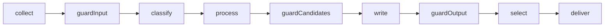

---
paths:
  - 'src/**/CLAUDE.md'
  - 'evals/**/CLAUDE.md'
---

# Feature CLAUDE.md format

A feature `CLAUDE.md` loads whenever an agent works in that folder. Write it for an agent about
to change the code: what the folder is for, where it sits, what must stay true, what breaks.
Diagrams carry the flow. Prose carries only what the diagrams and the code cannot.
Model: `src/classify/CLAUDE.md`. Diagrams agree with the system design in `docs/architecture/`
(`data-flow.md` for the chain). A feature's page for readers is `docs/features/<name>.md`: link
it, never copy it.

## Shape

| Section             | Holds                                                          | Budget         |
| ------------------- | -------------------------------------------------------------- | -------------- |
| `# Name` + `>` lead | Its job in the system; entry point and signature; its port     | 2-3 lines      |
| `## Context`        | Mermaid `flowchart LR`: neighbours, ports, data types on edges | ≤ 12 nodes     |
| `## Flow`           | Mermaid of how it works inside, then up to 4 notes             | ≤ 15 nodes     |
| `## Rules`          | Invariants, each "rule: why". This feature's only              | ≤ 8 bullets    |
| `## Files`          | File → role. One line on tests and fixtures                    | 1 row per file |
| `## Gotchas`        | Traps when changing it: pinned tests, consumers, limits        | ≤ 6 bullets    |

Total 40-80 lines; `src/digest` and `evals`, which span the whole chain, up to 90. A subfeature
folder: 20-45 lines, `## Context` optional.

## Diagrams

- `## Context` is always `flowchart LR`. `## Flow` is a `flowchart TD` for branching logic, or a
  `sequenceDiagram` when the story is calls between this feature and ports.
- Shapes: `id[code]` for a step, module or function; `id[[Port]]`; `id[(outside)]` for Ollama,
  feeds, disk, SMTP, Slack or config; `id{decision}`. Mark this feature `:::focus` and end the
  diagram with `classDef focus stroke-width:3px`. No colours: diagrams render in both themes.
- `-->` hands data on; label it with the type (`-->|"ScoredItem[]"|`). `-.->` calls a port or
  reads config.
- Labels use the names in the code. Quote every label that has brackets or punctuation, edge
  labels too: `a["decide (per item)"]`, `-->|"Item[]"|`. Never use `end` or `call` as a node id.
- `pnpm docs:mermaid` parses every block; `pnpm check` runs it.
- Pipeline steps use the names in `chainSteps` (`src/digest/stages/chainSteps.ts`), in this order:

## Cut

- Rules already in the root `CLAUDE.md` or `.claude/rules/*` (no adapter imports, `wrapUntrusted`,
  immutable data, named exports). Keep one only where this feature applies it in a way that is
  not obvious.
- "Depends on / used by" lists. The Context diagram shows the edges that matter; name a
  surprising consumer (evals, a test that scripts fakes) under Gotchas.
- Plain test commands (`pnpm vitest run src/x`). Keep a command only when it is special: slow,
  live, or needs a flag.
- Numbered prose the Flow diagram already shows. Issue ids and history, unless they explain a rule.

Plain English, present tense, short sentences. Backtick code names. Check every claim in the code.
