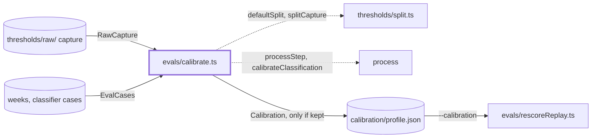
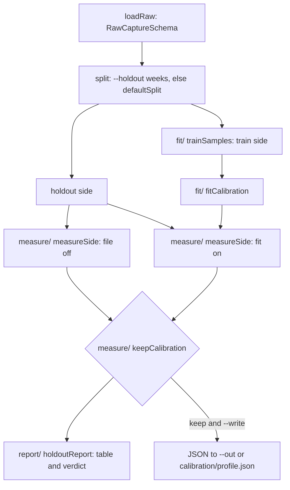

# Calibration

> Fits a monotone map from the decider's raw relevance to the labeled relevance, and says whether
> it helps on unseen weeks. By hand, no model call; reader page: `docs/evaluation/sets/classifier-cases.md`.
> Entry: `runCli(args, io)` returns an exit code (`evals/calibrate.ts`, which stays at that path).

## Context

## Flow

- Targets: a classifier case uses its label; a labeled week item uses 3 (must include) or 0 (must
  exclude). Failed calls and unlabeled items are skipped.
- Exit 0 means done, also on a `drop` verdict; 1 failed; 2 usage.

## Rules

- The fit reads the train side only: a holdout number must not have chosen anything.
- The file is kept only when holdout recall rises and leaks do not.
- `measureSide` uses the default thresholds (`ThresholdsSchema.parse({})`) and the top 5, not the
  local config: the verdict is the same on every machine.
- The map is monotone (`CalibrationSchema` refuses otherwise); the area bias is shrunk and capped.
- Nothing in a weekly run reads the file: `runDigest` passes no calibration to `processStep`.

## Files

| Path            | Role                                                                         |
| --------------- | ---------------------------------------------------------------------------- |
| `fit/`          | Train samples and the fit. See `fit/CLAUDE.md`                               |
| `measure/`      | Recall, leaks and accuracy of a side; the keep rule. See `measure/CLAUDE.md` |
| `report/`       | The table and the verdict line. See `report/CLAUDE.md`                       |
| `__fixtures__/` | `calibrationKit.ts`: a small raw capture, a lifting one, the week cases      |

The entry file `evals/calibrate.ts` holds `runCli`, `CalibrateIo`, the arguments and the write.

## Gotchas

- `--write` without `--out` writes `evals/calibration/<profile>.json`: data in the same folder as
  this code. Never edit it by hand; a new fit replaces it.
- `src/process/calibration.ts`, the docs and `docs/evaluation` name `evals/calibrate.ts`: keep the path.
- `fit/areaBias.ts` scores points through `calibrateClassification`, so a change to its
  interpolation moves the fit.
- A change to the default thresholds in `src/config/schema.ts` changes the verdict.
