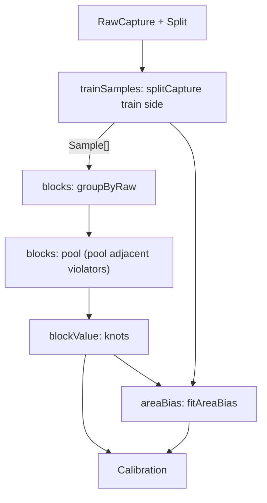

# Calibration fit

> Turns the train side of a raw capture into a `Calibration`: isotonic points plus a shrunk bias
> per area. Entry: `fitCalibration(samples, profile) → Calibration` (`fitCalibration.ts`) and
> `trainSamples(capture, split) → Sample[]` (`trainSamples.ts`). Pure, no port.

## Flow

## Rules

- Only train records become samples; failed calls and unlabeled week items are skipped.
- No sample at all throws `DigestError`: there is nothing to fit.
- `pool` merges neighbours whose means are equal or fall, so `calibrated` rises strictly and the
  result passes `CalibrationSchema`.
- An area with n samples keeps n / (n + 5) of its mean error, and no area moves by more than 0.5.
- `evaluate` (`areaBias.ts`) runs the points through `calibrateClassification`, so the error the
  bias fits is the error the process step would leave.

## Files

| File                | Role                                                              |
| ------------------- | ----------------------------------------------------------------- |
| `types.ts`          | `Sample`: raw score, area, target                                 |
| `trainSamples.ts`   | `trainSamples`: the train side as samples (3 or 0 for week items) |
| `blocks.ts`         | `Block`, `groupByRaw`, `pool`, `blockValue`                       |
| `areaBias.ts`       | `evaluate`, `fitAreaBias`, `Points`                               |
| `fitCalibration.ts` | `fitCalibration`: the points and the bias together                |

Tests sit next to each file; `../__fixtures__/calibrationKit.ts` has the `sample` builder.

## Gotchas

- `blocks.test.ts` and `areaBias.test.ts` pin exact numbers (the 2 / 7 shrink, the 0.5 cap).
