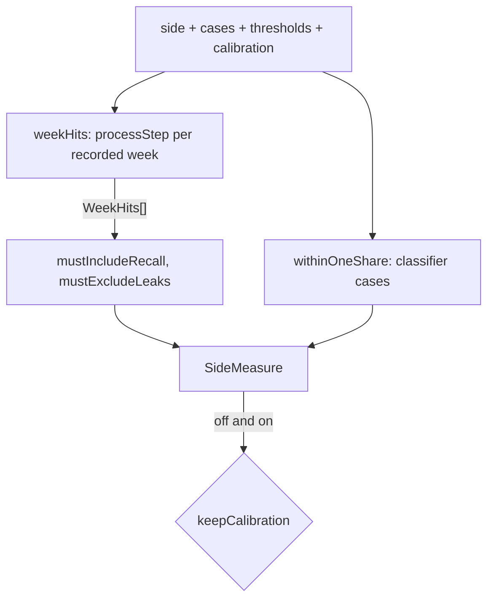

# Calibration measure

> Scores one side of a capture with a calibration off or on, and decides whether to keep it.
> Entry: `measureSide(side, cases, thresholds, calibration, topN = 5) → SideMeasure`
> (`measureSide.ts`) and `keepCalibration(off, on) → boolean` (`keepCalibration.ts`).

## Flow

## Rules

- `weekHits` leaves out a week with no captured item, a record whose item the week lacks, and a
  failed call. `visibleIds` lists only the items that were scored.
- A week with nothing to count gives recall and leaks 0, never null.
- `withinOneShare` skips failed calls and is null when no case succeeded; with a file it scores the
  calibrated relevance.
- `keepCalibration` is strict on recall (`>`) and loose on leaks (`<=`); within-one is not part of it.

## Files

| File                 | Role                                                        |
| -------------------- | ----------------------------------------------------------- |
| `measureSide.ts`     | `measureSide`, `SideMeasure`, the top-5 default             |
| `weekHits.ts`        | `weekHits`: the process step's pick next to the week labels |
| `withinOneShare.ts`  | `withinOneShare`: classifier cases within one point         |
| `keepCalibration.ts` | `keepCalibration`: the rule for writing the file            |

Tests sit next to each file and use `../__fixtures__/calibrationKit.ts`.

## Gotchas

- Callers pass the thresholds. `evals/calibrate.ts` passes the schema defaults, not the local config.
- `report/holdoutReport.ts` imports `SideMeasure` from here, never the other way round.
