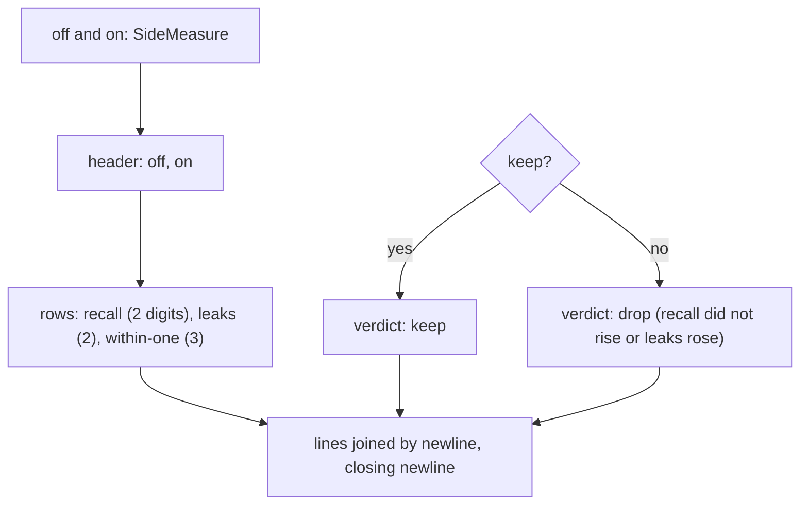

# Calibration report

> The text `evals/calibrate.ts` prints after a run: a table of the holdout with the file off and on,
> and the verdict. Entry: `holdoutReport(off, on, keep) → string` (`holdoutReport.ts`). Pure.

## Flow

## Rules

- The text is the command's output: `holdoutReport.test.ts` pins every space. A change here changes
  what people read and what the docs quote.
- A value that was not measured (`withinOne` null) prints `n/a`.
- The label column is 22 wide and each value 8 wide, right-aligned.
- It only formats: the keep rule stays in `measure/keepCalibration.ts`, and the report takes the
  decision as a boolean.

## Files

| File               | Role                                              |
| ------------------ | ------------------------------------------------- |
| `holdoutReport.ts` | `holdoutReport`: header, three rows, verdict line |

The test calls it with fixed numbers and compares the whole string.

## Gotchas

- The text ends with a newline, so the caller writes it as it is.
- `wrote <path>` is printed by `evals/calibrate.ts`, not here.
