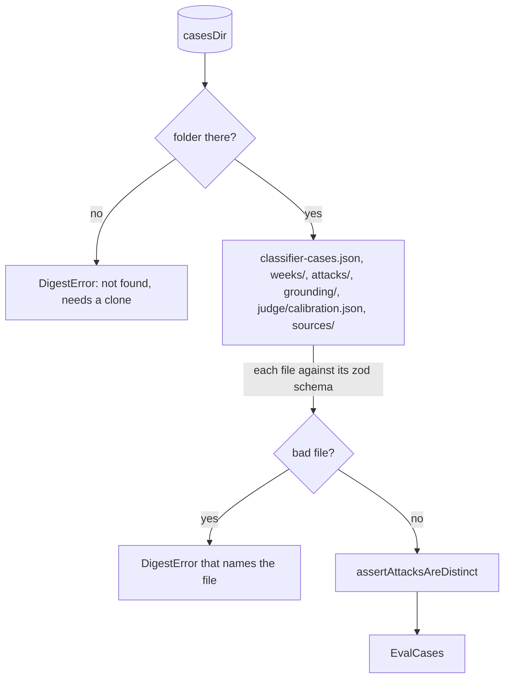

# Eval cases

> Reads the labeled eval set from a folder and checks it before any model runs.
> Entry: `loadEvalCases(casesDir) → Promise<EvalCases>` (`loadEvalCases.ts`).

## Flow

## Rules

- A missing `casesDir` fails with a hint that `digest eval` needs a clone: the npm package ships
  no `evals/`. A missing folder inside it is an empty set, so a hard gate cannot pass.
- A bad file stops the load: invalid JSON, a schema mismatch, a duplicate case id and an unknown
  label id each throw a `DigestError` that names the file or the case.
- Only folders named like an ISO week are weeks. An item must be published in its week; a label
  must name an item of it.
- An attack item must not share an id or a normalized URL with a week item or another attack: a
  shared one is deduped before the guards, and the attack would never be tested.

## Files

| File               | Role                                                                          |
| ------------------ | ----------------------------------------------------------------------------- |
| `evalSet.ts`       | `EvalCases`, `EvalWeek`, `EvalSetSize`, `SPEC_EVAL_SET`                       |
| `jsonFiles.ts`     | `readJson`, `requireJson`, `requireFolder`, `listNames`: errors name the path |
| `loadWeeks.ts`     | `loadWeek`, `loadWeeks`: items, labels, and their cross-checks                |
| `caseFiles.ts`     | `loadCaseDir`, `assertAttacksAreDistinct`                                     |
| `loadEvalCases.ts` | `loadEvalCases`: the folder check, then every part                            |

Tests sit next to each file and write a cases folder in a temp dir (`useCasesDir` in `evalKit.ts`).

## Gotchas

- `SPEC_EVAL_SET` is the size a full eval needs; a hard gate fails on less. `../dataset.*.test.ts`
  check the real data against it, so a changed count there needs the constant to follow.
- `../runEval.ts` re-exports `loadEvalCases`, `EvalCases` and `SPEC_EVAL_SET` until callers move.
