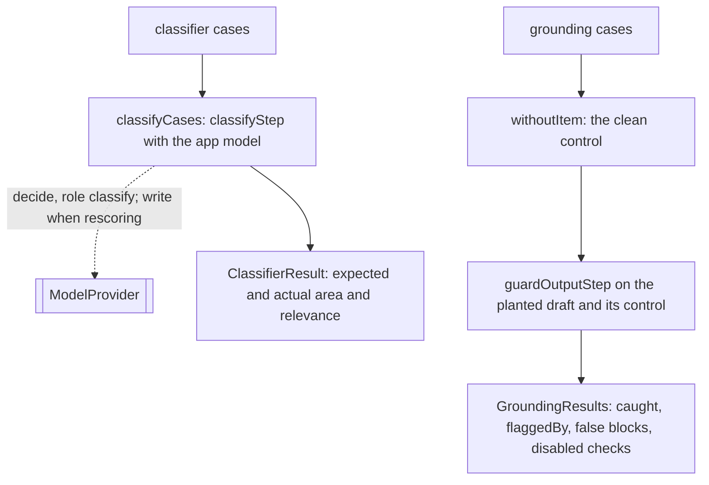

# Classifier and grounding runs

> The two labeled case sets that need no week replay: classifier cases through the classify step,
> and planted-claim drafts through the output guards.
> Entries: `classifyCases(app, cases) → ClassifierResult[]`, `checkGrounding(app, cases) → GroundingResults`.

## Flow

## Rules

- `classifyCases` calls `classifyStep` with the app's `focusAreas`, source area hints and, when
  `models.rescoreWithWriter` is on, the writer rescoring above `thresholds.minRelevance`. It is off
  by default.
- The classify step must return one result per case; any other count throws a `DigestError`, since
  labels would be scored against the wrong items.
- `checkGrounding` uses a fresh default guard config, not the app's: all output checks run. A check
  with no guard, or switched off, is in `disabledChecks` and the metric reads "not measured".
- The control is the planted draft without the planted item. What a guard flags on it is a false
  block, kept apart from what it flags on the planted draft (a catch).
- In mode `any` the later guard never sees a draft an earlier one flagged, so `flaggedBy` lists the
  checks that actually ran on it.

## Files

| File                | Role                                 |
| ------------------- | ------------------------------------ |
| `classifyCases.ts`  | `classifyCases`                      |
| `checkGrounding.ts` | `checkGrounding`, `GroundingResults` |

Tests sit next to each file and script `FakeModelProvider` and `FakeOutputGuard`. No fixtures.

## Gotchas

- With `models.rescoreWithWriter` on, `classifierAccuracy` is rescored but the week replays run
  `runDigest`: compare cards only if `runDigest` rescores too.
