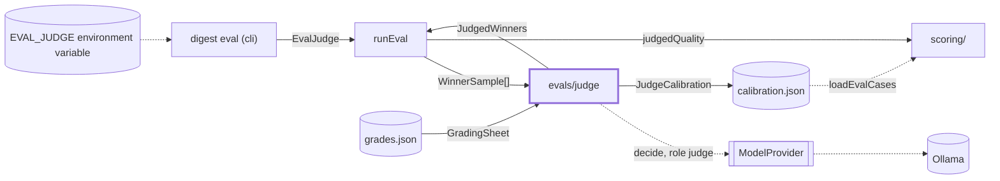
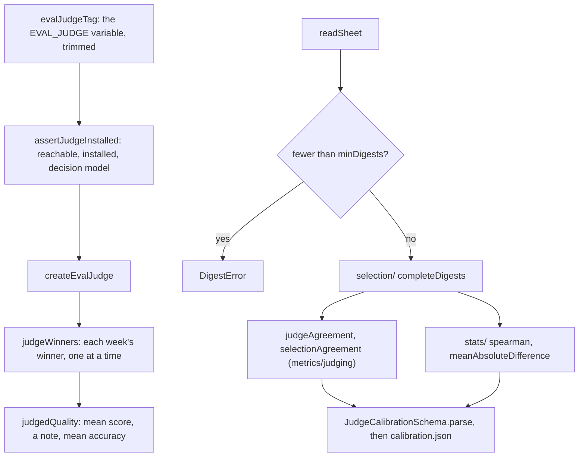

# Eval judge

> The judge `digest eval` uses on a profile that has none, and the check that says whether it can be
> trusted. Entries: `createEvalJudge`, `assertJudgeInstalled` (`evalJudge.ts`), `judgeWinners`
> (`judgeWinners.ts`), `calibrate` (`calibrate.ts`). Port: `ModelProvider.decide`, role `judge`.

## Context

## Flow

- The first chain runs in `digest eval`. The second runs by hand, calls no model, and takes the
  sheet, the output and `--min-digests N`: `pnpm exec tsx evals/judge/calibrate.ts`.
- `runCalibration` prints the report and whether the judge clears `JUDGE_AGREEMENT_MIN`; `main`
  turns any error into `calibrate failed: ...` and exit code 1.

## Rules

- `EVAL_JUDGE` in this folder is the environment variable (`EnvSchema`), which the error texts name
  because the user sets it. It is not `OVERRIDE_JUDGE` of `src/config/profiles.ts`, the model tag that
  `resolveProfile` gives a multi-writer run as its judge. Nothing here imports the constant.
- The judge runs last and one week at a time, only for a profile without a judge: the model loads
  once, after every replay (`runEval` orders it).
- A `DigestError` on one week is listed and logged and the other weeks keep their scores. Any other
  error propagates: a bug in the judge must not pass as a missing week.
- `JudgedWinners.accuracies` keeps the judge's accuracy rating of each scored winner;
  `judgedQuality` reports the mean as `detail.meanAccuracy`. It is reported next to writing quality
  and gates nothing. A reply without an accuracy rating adds none.
- `assertJudgeInstalled` reads the model list and never pulls a model. It fails before the replay,
  and strips `user:pass@` from the reason, which can name the Ollama URL.
- A half-filled sheet never yields a number, and a sheet under `minDigests` (`GRADED_DIGESTS`, 10)
  is refused: a lucky pair must not un-gate the judge.
- Trust is decided elsewhere: `evaluateGate` (`metrics.ts`) compares `judgeAgreement` with
  `JUDGE_AGREEMENT_MIN` (`metrics/judging/judgeMetrics.ts`). Here it is only measured and reported.
- `evals/rubric.md` says in words what `src/select/judgePrompt.ts` asks. Change one, change the
  other: the maintainer grades by the same rubric.

## Files

| Path                   | Role                                                                                      |
| ---------------------- | ----------------------------------------------------------------------------------------- |
| `evalJudge.ts`         | `EvalJudge`, `createEvalJudge`, `evalJudgeTag`, `assertJudgeInstalled`                    |
| `judgeWinners.ts`      | `judgeWinners`, `judgedQuality`, `WinnerSample`, `JudgedWinners`                          |
| `gradingSheet.ts`      | `GradingSheetSchema`, `GRADED_DIGESTS`, `createGradingSheetTemplate`                      |
| `calibrate.ts`         | `calibrate`, `runCalibration`, `main`: sheet in, `JudgeCalibration` out, report           |
| `grades.template.json` | The blank sheet the maintainer copies to `grades.json`                                    |
| `stats/`               | Rank correlation and mean absolute difference. See `stats/CLAUDE.md`                      |
| `selection/`           | Complete rows, the judge's pick per week, the pairs to compare. See `selection/CLAUDE.md` |

Tests sit next to each file; builders in `__fixtures__/sheetKit.ts`. Reader page: `docs/evaluation/sets/judge.md`.

## Gotchas

- `src/cli/eval/eval.ts` imports `assertJudgeInstalled`, `createEvalJudge`, `evalJudgeTag`,
  `EvalJudge`; `runEval.ts` and `scoring/` import `judgeWinners`, `judgedQuality`, `JudgedWinners`.
  Renaming any of them breaks those. `evalJudge.test.ts` and `src/cli/eval/eval.test.ts` pin the error texts.
- `grades.json` and `calibration.json` are not committed yet. `evals/calibrate.ts`, one level up,
  is the threshold calibration: a different tool with a similar name.
- `stats/rankCorrelation.ts` is not `metrics/ranking/spearman.ts`. This one clamps to -1..1,
  because `JudgeCalibrationSchema` rejects more, and takes human and judge pairs.
- `judgeInHarness.test.ts` runs `runEval` (with `../evalKit`): a harness change can break it.
