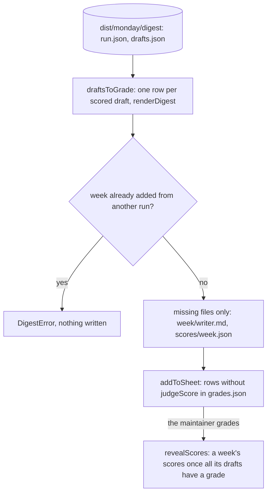

# Run drafts

> Turns a saved quality run into rows of the grading sheet: each draft the judge scored, saved as
> the run printed it, with its score kept apart until its week is graded. Entries:
> `addRun(options)`, `reveal(options)`, `main` (`addRun.ts`). Calls no model.

## Flow

- `pnpm exec tsx evals/judge/runDrafts/addRun.ts dist/<monday>/digest` adds a run;
  `--reveal` fills the scores. `--judge-dir` and `--sheet` move the files (tests use them).

## Rules

- A score reaches `grades.json` once every draft of its week has a grade, and never the output: seen
  first, it would anchor the grade. It sits in `scores/`, not beside the drafts read.
- A draft is saved exactly as the run rendered it (`renderDigest`, the run's `disabledGuards`), so
  the winner's file equals the run's `digest.md`: the maintainer grades what shipped.
- A week is added once. The same run again only fills in missing files, never rewrites a draft
  that may be graded; another run of that week is refused, or new drafts would sit under old grades.
- Scores from another judge are refused, on add and on reveal: they would not be comparable.
- `writerSlug` keeps only letters and digits, so a writer tag never becomes a path; two writers
  with one file name are refused. Writes are atomic (`writeFileAtomic`): the sheet holds hand grades.

## Files

| File         | Role                                                                                       |
| ------------ | ------------------------------------------------------------------------------------------ |
| `runPair.ts` | `draftsToGrade`, `judgeScoresOf`, `scoresFile`, `addToSheet`, `revealScores`, `writerSlug` |
| `addRun.ts`  | `addRun`, `reveal`, `main`: the files in and out, and the command line                     |

`runPair.test.ts` is pure; `addRun.test.ts` works in a temp folder.

## Gotchas

- The saved `<week>/*.md` are in `.prettierignore`: formatting would re-align their tables.
- `../gradingSheet.ts` names this command in the sheet's instructions; `../grades.template.json`
  must match it (`gradingSheet.test.ts`).
