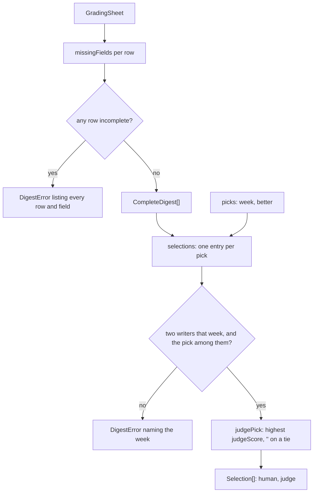

# Judge selection

> Turns a grading sheet into the weeks to compare: the draft the maintainer picked and the one the
> judge scored highest. Entries: `completeDigests(sheet)`, `selections(digests, picks)`,
> `judgePick(drafts)`. Pure: no port, no file, no model.

## Flow

## Rules

- `completeDigests` lists every incomplete row and field in one error: one run shows what is left.
- A tie at the top of a week (scores within `SCORE_TIE_EPSILON`, 1e-9, as in `src/select`) is no
  judge pick (`''`), so it never equals a maintainer pick. The select step breaks such a tie by
  writer order, which is kinder to the judge.
- A pick needs a week with digests from two different writers, and a `better` that is one of them.
  Weeks without a pick are left out, and a sheet without picks is refused.

## Files

| File                 | Role                                                  |
| -------------------- | ----------------------------------------------------- |
| `types.ts`           | `CompleteDigest`, `Selection`                         |
| `completeDigests.ts` | `completeDigests`, `missingFields`                    |
| `judgePick.ts`       | `judgePick`, `SCORE_TIE_EPSILON`                      |
| `selections.ts`      | `selections`: the pairs `selectionAgreement` compares |

Tests sit next to each file; `row()` and `sheetOf()` come from `../__fixtures__/sheetKit.ts`.

## Gotchas

- Imports the sheet types from `../gradingSheet`, never `../calibrate`. `../calibrate.test.ts` also
  matches parts of the error texts through `calibrate()`.
