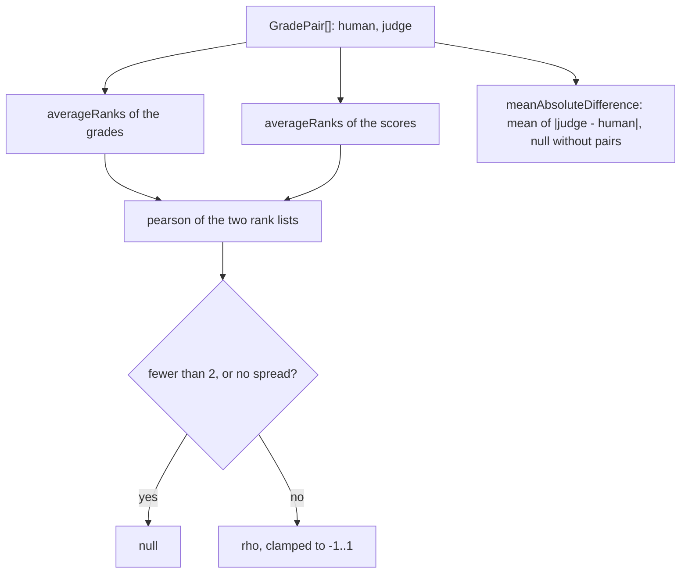

# Judge statistics

> How far the judge's scores sit from the maintainer's grades. Entries: `spearman(pairs)`,
> `averageRanks`, `pearson` (`rankCorrelation.ts`); `meanAbsoluteDifference(pairs)`
> (`meanAbsoluteDifference.ts`). Pure: numbers in, a number or null out. No port, no file.

## Flow

## Rules

- A correlation that does not exist is `null`, never 0: fewer than two pairs, or one side that
  never changes. The report then says it is undefined.
- Equal values share the mean of the ranks they span (`averageRanks`), so a tie in the grades does
  not invent an order.
- `pearson` clamps to -1..1: rounding can push a perfect correlation a hair past 1, and
  `JudgeCalibrationSchema` rejects that.
- `mean` returns NaN for an empty list. Callers check for no pairs first, as `meanAbsoluteDifference` does.

## Files

| File                        | Role                                                 |
| --------------------------- | ---------------------------------------------------- |
| `types.ts`                  | `GradePair`: one digest's hand grade and judge score |
| `mean.ts`                   | `mean`                                               |
| `rankCorrelation.ts`        | `averageRanks`, `pearson`, `spearman`                |
| `meanAbsoluteDifference.ts` | `meanAbsoluteDifference`                             |

Tests sit next to each file and build pairs with `pairs()` from `../__fixtures__/sheetKit.ts`.

## Gotchas

- Only `../calibrate.ts` calls these. `metrics/ranking/spearman.ts` is a second Spearman for the
  classifier (no clamp, other pair type). Keep them apart until a caller needs one.
- `mean` here is not `mean` in `metrics/measurement/numbers.ts`, which returns null for no values.
