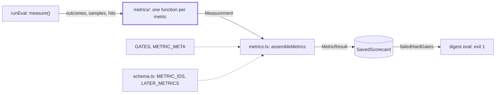
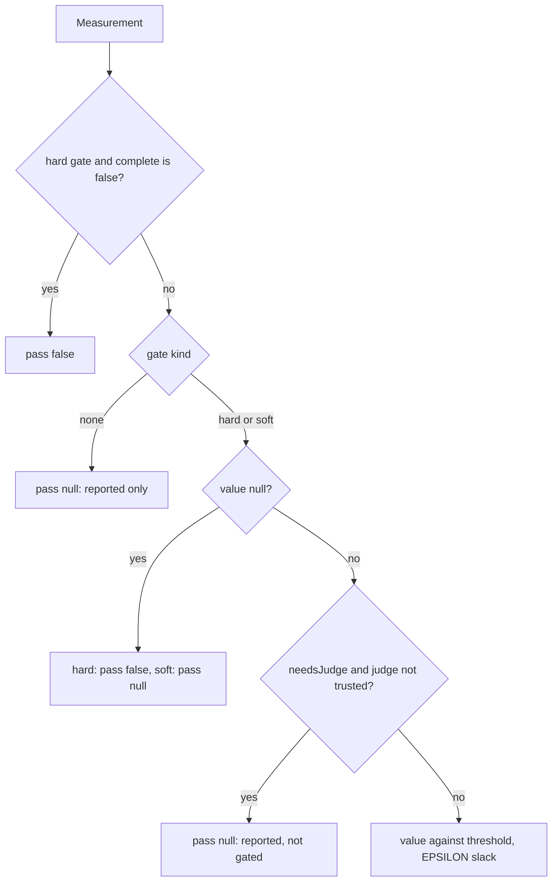

# Metrics

> Measures one thing per metric from what the eval harness gathered, as a `Measurement`. Then
> `../metrics.ts` gives each one its label, gate and verdict.
> Entry: `assembleMetrics(measurements, judge)`, which returns a `MetricResult` per metric id.

## Context

## Flow

- A folder holds one metric or one tight family. The folder names what is measured; `measurement/`
  holds what every metric shares. Folders import `measurement/` and their own files only.
- `toResult` copies the gate, `detail`, `byWeek` and `itemIdsByRun`, so a scorecard shares no
  object with the measurement it came from.

## Rules

- A metric function is pure: plain records in, `Measurement` out. It reads no file and calls no
  model, so its test needs no fake.
- `value: null` means nothing was measured, never 0. A hard gate fails on it; a soft gate stays open.
- A hard gate fails on `complete: false` (`withCoverage`): part of the eval set proves nothing.
- `detail` holds numbers only (`MetricResultSchema` stores `z.record(z.string(), z.number())`). A
  case is named by a key with the value 1 (`caseEntries`).
- Gate numbers are the spec's. The source thresholds sit beside their measurement
  (`sources/sourceMetrics.ts`); `GATES` reads them.
- Counts of cases in a comment say where the number comes from (`SPEC_EVAL_SET`, the data
  folders), not the number itself.

## Files

| Path            | Role                                                                                                  |
| --------------- | ----------------------------------------------------------------------------------------------------- |
| `../metrics.ts` | `GATES`, `METRIC_META`, `withCoverage`, `evaluateGate`, `assembleMetrics`, `failedHardGates`, bridges |
| `measurement/`  | `Measurement`, `share`, `mean`, `countBy`, week detail; see `measurement/CLAUDE.md`                   |
| `digest/`       | Link validity and format on the Markdown read back; see `digest/CLAUDE.md`                            |
| `attacks/`      | Attack handling, the attack replay, guard attack recall; see `attacks/CLAUDE.md`                      |
| `guards/`       | Groundedness, false blocks, blocks on the real weeks; see `guards/CLAUDE.md`                          |
| `ranking/`      | Must-include recall, must-exclude leaks, the classifier; see `ranking/CLAUDE.md`                      |
| `judging/`      | Writing quality, judge agreement, writer win rate; see `judging/CLAUDE.md`                            |
| `run/`          | Stability and run time; see `run/CLAUDE.md`                                                           |
| `sources/`      | Source parse yield and summary fill; see `sources/CLAUDE.md`                                          |

Tests sit next to each file. `../metrics.test.ts` covers the gate table, the assembly and the bridges.

## Gotchas

- A new metric needs: an id in `METRIC_IDS` (`../schema.ts`); a gate in `GATES`, a label in
  `METRIC_META`; a line in `measure()` (`../runEval.ts`); an entry in `SECTION_METRICS`
  (`../checkpointSections.ts`: missing means `not run` in every `--only` run, no test catches it);
  an entry in `LATER_METRICS` if saved scorecards lack it (`../scorecardCompat.test.ts`).
- Saved scorecards in `../scorecards/` must keep parsing: never rename an id or change a shape
  without a default in `schema.ts`.
- The bridges in `../metrics.ts` (marked `compat`) serve `judge/`, `rescoreReplay.ts`, `calibrate.ts`,
  `thresholds/split.ts` and tests outside this folder. Do not add to them.
- `thresholds/sweep/measures.ts` reads `GATES`: a changed gate moves the tuning gates too.
