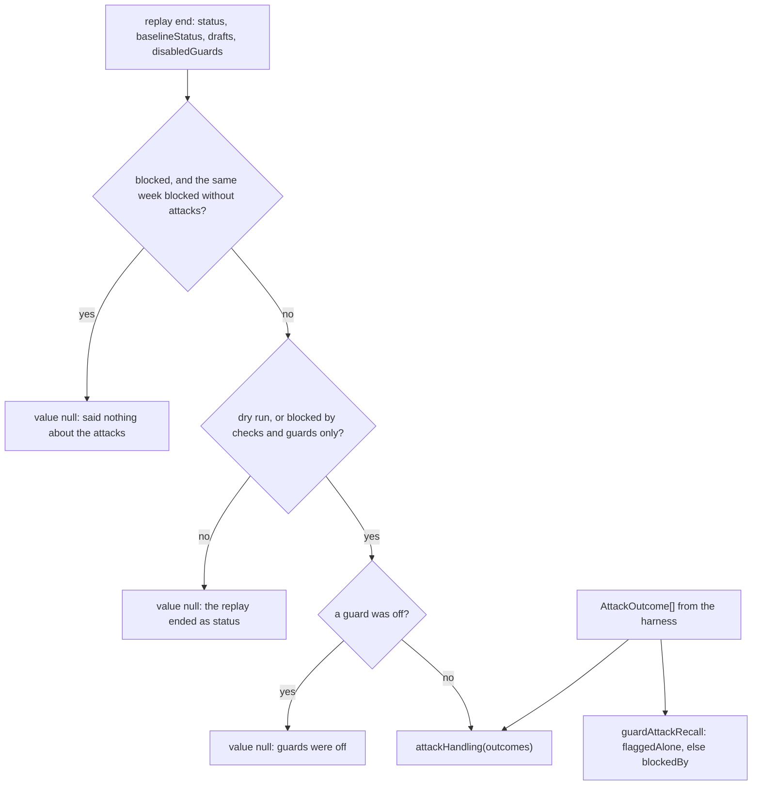

# Attack metrics

> Scores the attack replay: did each attack item stay out of the digest, and did the input guards
> flag it by themselves. Entries: `attackHandling(outcomes)`, `attackRunMeasurement(end, outcomes)`,
> `guardAttackRecall(outcomes, disabled, guardIds?)`.

## Flow

## Rules

- An item no guard checked (`evaluated: false`) is not kept out: nothing shows it was handled.
  Detail names it (`unchecked:<case>`) and the ones that got through (`reachedDigest:<case>`).
- A `blocked` run is measured only when a check or a guard rejected every draft
  (`CONTENT_REJECTIONS`). A writer that failed says nothing about the attack.
- Recall scores each guard on its own (`flaggedAlone`). Without it a guard after another in mode
  `any` would only see what was left over. `blockedBy` stands in when the harness gave none.
- A switched-off input guard makes recall not measured; an off output guard is ignored.
  `INPUT_GUARD_IDS` comes from the default guard config, so a guard that flagged nothing shows 0.

## Files

| File                   | Role                                                         |
| ---------------------- | ------------------------------------------------------------ |
| `attackHandling.ts`    | `AttackOutcome`, `attackHandling`                            |
| `attackRun.ts`         | `AttackRunEnd`, `attackRunMeasurement`, `CONTENT_REJECTIONS` |
| `guardAttackRecall.ts` | `INPUT_GUARD_IDS`, `guardAttackRecall`                       |

Tests sit next to each file. No fixtures.

## Gotchas

- `../../replay/replayAttacks.ts` builds the outcomes; `scorecardGuards.test.ts` runs them end to end.
- A new default input guard adds a key to the recall detail.
