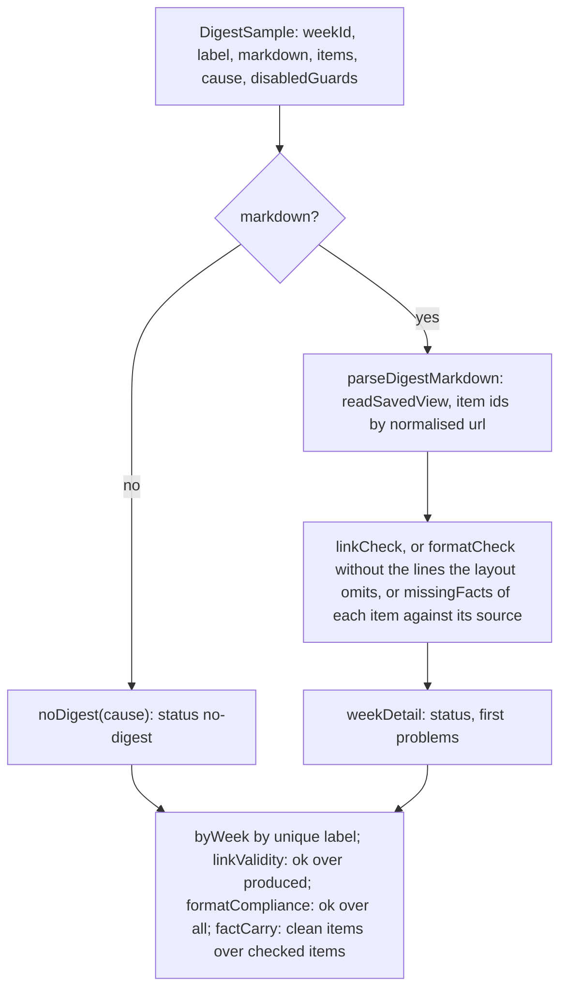

# Digest metrics

> Scores the Markdown a run wrote by reading it back. Entries: `linkValidity(samples)`
> (`linkValidity.ts`), `formatCompliance(samples)` (`formatCompliance.ts`), `factCarry(samples)`
> (`factCarry.ts`), `parseDigestMarkdown`, `digestItemIds` (`parseDigest.ts`).

## Flow

## Rules

- The checks judge the file, not the object that made it: the digest is parsed back from the
  Markdown as written to disk. Items come back grouped by urgency, as printed, with area `unknown`.
- A link to a URL nobody collected gets the id `unmatched:<url>`, so `linkCheck` rejects it. The
  parser never throws; text that is not a digest gives empty parts.
- The layout prints no intro and no why-it-matters line, so `formatCompliance` drops those two
  problems (`NOT_PRINTED_PROBLEM`): it cannot ask for what the file does not show.
- `linkValidity` leaves a week without a digest out of the value; `formatCompliance` counts it as
  a failure. No digest has no links to get wrong, but it did not meet the format.
- `factCarry` checks the title, summary and action of each shipped item against the title and
  summary of the collected item its link names (`missingFacts`, `src/write/provenance`). It skips a
  week without a digest and an item with an `unmatched:` link, and names both in the note. The
  value counts an item once however many facts it gets wrong.
- What a wrong fact is comes from `missingFacts` alone, the same call the title repair makes: a
  shorter form of a plain source version is present (`1.31` for `v1.31.2`), a pre-release must
  match exactly (`1.17` and `1.17.0` are missing for `1.17.0-beta1`). The metric has no rule of its
  own, so it cannot call a title wrong that the pipeline accepts.
- A `factCarry` miss is a `byWeek` problem line: part, fact, and `passedBy`, the layers that let it
  through (`linkCheck`, `formatCheck` and each output guard not in the run's `disabledGuards`).
  The output guard ids come from the config schema, so a new output guard is picked up.

## Files

| File                  | Role                                                                 |
| --------------------- | -------------------------------------------------------------------- |
| `parseDigest.ts`      | `parseDigestMarkdown`, `digestItemIds`                               |
| `digestSample.ts`     | `DigestSample`, `checkedSamples`, `sampleLabels`: a check per sample |
| `linkValidity.ts`     | `linkValidity`                                                       |
| `formatCompliance.ts` | `formatCompliance`, `printedFormatCheck`                             |
| `factCarry.ts`        | `factCarry`, `factsOfWeek`, `FactMiss`: the facts of a digest        |

Tests render digests with `renderDigest` and the builders in `test/`. No fixtures.

## Gotchas

- `parseDigestMarkdown` follows the layout `readSavedView` reads (`src/render/markdown.ts`): a
  layout change moves the scores. `parseDigest.test.ts` round-trips `renderDigest` to catch it.
- `formatCompliance.test.ts` pins the wording of the two dropped problems against `formatCheck`.
- `factCarry` reads a fact only where `factTokensOf` finds one. A change to what counts as a fact,
  or to the shorter-version rule in `missingFacts`, moves the scores, and every pattern there must
  stay linear: the digest is model output.
