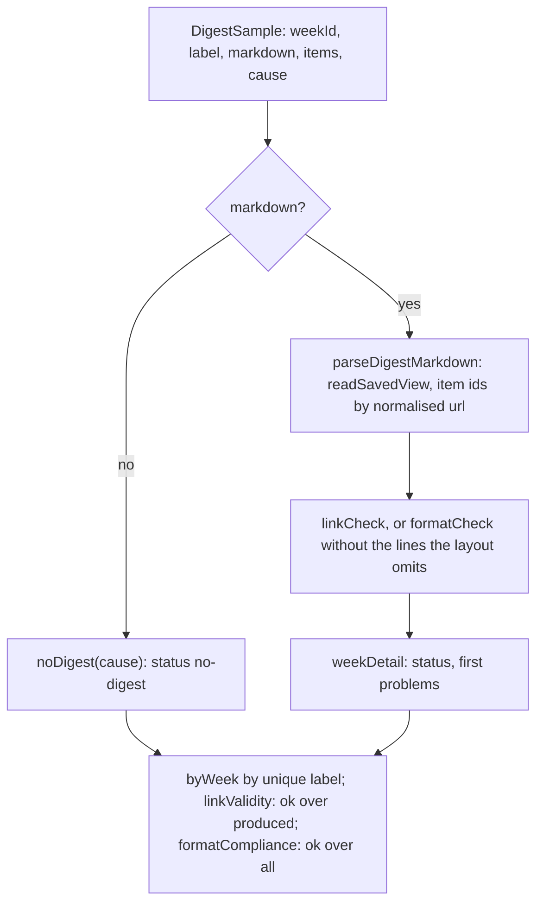

# Digest metrics

> Scores the Markdown a run wrote by reading it back. Entries: `linkValidity(samples)`
> (`linkValidity.ts`), `formatCompliance(samples)` (`formatCompliance.ts`), `parseDigestMarkdown`,
> `digestItemIds` (`parseDigest.ts`).

## Flow

## Rules

- The checks judge the file, not the object that made it: the digest is parsed back from the
  Markdown as written to disk. Items come back grouped by urgency, as printed, with area `unknown`.
- A link to a URL nobody collected gets the id `unmatched:<url>`, so `linkCheck` rejects it. The
  parser never throws; text that is not a digest gives empty parts.
- The layout prints no intro and no why-it-matters line, so `formatCompliance` drops those two
  problems (`NOT_PRINTED_PROBLEM`): it cannot ask for what the file does not show.
- `linkValidity` leaves a week without a digest out of the value; `formatCompliance` counts it as
  a failure. No digest has no links to get wrong, but it did not meet the format.

## Files

| File                  | Role                                                                 |
| --------------------- | -------------------------------------------------------------------- |
| `parseDigest.ts`      | `parseDigestMarkdown`, `digestItemIds`                               |
| `digestSample.ts`     | `DigestSample`, `checkedSamples`: runs a check per sample, labels it |
| `linkValidity.ts`     | `linkValidity`                                                       |
| `formatCompliance.ts` | `formatCompliance`, `printedFormatCheck`                             |

Tests render digests with `renderDigest` and the builders in `test/`. No fixtures.

## Gotchas

- `parseDigestMarkdown` follows the layout `readSavedView` reads (`src/render/markdown.ts`): a
  layout change moves the scores. `parseDigest.test.ts` round-trips `renderDigest` to catch it.
- `formatCompliance.test.ts` pins the wording of the two dropped problems against `formatCheck`.
