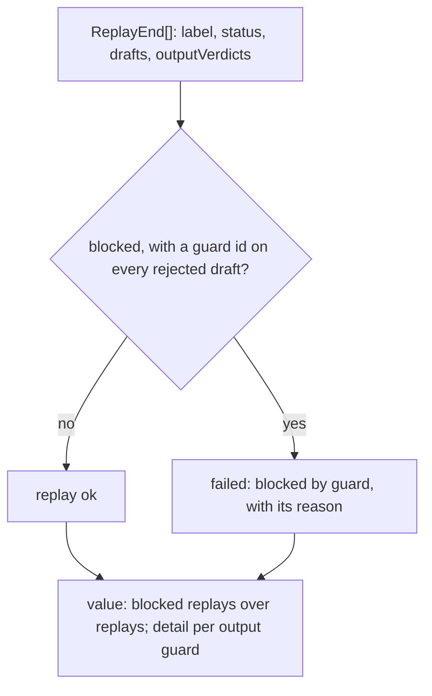

# Guard metrics

> Scores the output guards: planted false claims they catch, clean controls they wrongly flag, and
> real-week replays they block. Entries: `groundedness(outcomes)`, `guardFalseBlocks(tallies)`,
> `guardRealBlocks(ends)`, `noDigestCause(end)`.

## Flow

## Rules

- A guard block needs a guard id on every rejected draft. A run only `linkCheck` or `formatCheck`
  rejected is not one; a draft rejected by both a guard and a check counts.
- `noDigestCause` names why a replay has no digest: `blocked by <guards>`, `rejected by <checks>`,
  else `run ended as "<status>"`. The harness puts it in `DigestSample.cause`.
- The block reason is model text: `blockMessage` cuts it to `MAX_PROBLEM_CHARS`.
- `guardRealBlocks` counts every replay, the stability runs included, and numbers a repeated
  label so each shows in `byWeek`.
- `guardFalseBlocks` gates on the worst guard's rate and names the clean cases it flagged
  (`flagged:<guard>:<case>`). A guard that checked nothing is left out; with none, the value is null.

## Files

| File                  | Role                                                                   |
| --------------------- | ---------------------------------------------------------------------- |
| `groundedness.ts`     | `GroundingOutcome`, `groundedness`                                     |
| `guardFalseBlocks.ts` | `GuardTally`, `guardFalseBlocks`                                       |
| `guardRealBlocks.ts`  | `ReplayEnd`, `OutputVerdictRecord`, `guardRealBlocks`, `noDigestCause` |

Tests sit next to each file. No fixtures.

## Gotchas

- `../../runEval.ts` builds `ReplayEnd` (`replayEndOf`, keeping each flagged verdict's reason);
  `scorecardGuards.test.ts` runs the whole path.
- Every output guard in the default config shows in the detail, even at 0: a new default output
  guard adds a key to saved results.
