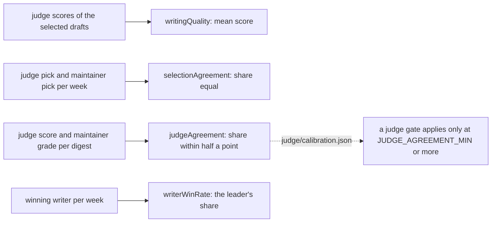

# Judge metrics

> Scores the judge and the writers: the quality of the winning drafts, how far the judge agrees with
> the maintainer, and which writer wins. Entries: `writingQuality`, `selectionAgreement`,
> `judgeAgreement`, `JUDGE_AGREEMENT_MIN` (`judgeMetrics.ts`); `writerWinRate` (`writerWinRate.ts`).

## Flow

## Rules

- `JUDGE_AGREEMENT_MIN` decides trust. Below it, or with no calibration, the two judge gates
  (`writingQuality`, `selectionAgreement`) are reported and not gated: an untrusted judge must not
  fail a run. `evaluateGate` in `../../metrics.ts` reads it.
- `selectionAgreement` and `judgeAgreement` are measured on the hand-graded digests by
  `evals/judge/calibrate.ts`, which writes `calibration.json`. A normal eval reads those numbers.
- A judge score within half a point of the grade counts as agreement, with `EPSILON` slack.
- `writerWinRate` is reported, never gated. The value is the leader's share; detail has every writer's.

## Files

| File               | Role                                                                            |
| ------------------ | ------------------------------------------------------------------------------- |
| `judgeMetrics.ts`  | `writingQuality`, `selectionAgreement`, `judgeAgreement`, `JUDGE_AGREEMENT_MIN` |
| `writerWinRate.ts` | `writerWinRate`                                                                 |

Tests sit next to each file. No fixtures.

## Gotchas

- `evals/judge/calibrate.ts` and `judgeWinners.ts` import these through the bridge in
  `../../metrics.ts`.
- A writer tag is a key in `detail`; `countBy` handles tags that look like object properties.
