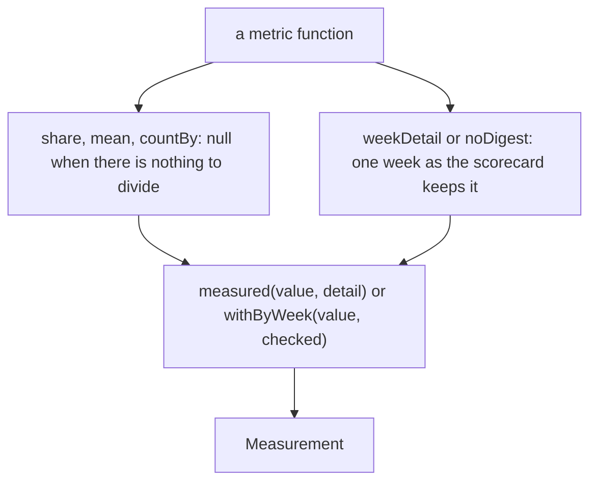

# Measurement

> The shape every metric function returns and the small helpers they share. Entries: `Measurement`,
> `measured`, `withByWeek`, `caseEntries` (`measurement.ts`); `share`, `mean`, `countBy`, `EPSILON`
> (`numbers.ts`); `weekDetail`, `noDigest`, `uniqueLabels` (`weekDetail.ts`).

## Flow

## Rules

- `share` and `mean` return null for no data, never 0: a metric with nothing behind it reads as not
  measured.
- `detail` is numbers only, so a case is named by a key with the value 1 (`caseEntries`).
- `countBy` checks own keys: writer tags and guard ids go in as keys, and `constructor` is one.
- A week keeps at most `MAX_PROBLEMS_PER_WEEK` problems and cuts each to `MAX_PROBLEM_CHARS`: a
  problem can quote a URL a model wrote, and scorecards are committed.
- Every tolerance and threshold comparison uses `EPSILON`, so a value exactly on a threshold
  passes despite floating-point noise.
- `uniqueLabels` numbers a repeat `w (2)`, so two replays of one week never share a `byWeek` key.

## Files

| File             | Role                                                                                   |
| ---------------- | -------------------------------------------------------------------------------------- |
| `measurement.ts` | `Measurement`, `CheckedWeek`, `measured`, `withByWeek`, `caseEntries`                  |
| `numbers.ts`     | `EPSILON`, `share`, `mean`, `countBy`                                                  |
| `weekDetail.ts`  | `weekDetail`, `noDigest`, `uniqueLabels`, `MAX_PROBLEMS_PER_WEEK`, `MAX_PROBLEM_CHARS` |

Tests sit next to each file. No fixtures.

## Gotchas

- `evals/judge/`, `evals/scoring/` and the `src/cli/eval` tests import the `Measurement` type from here.
- A new field on `Measurement` also needs a field on `MetricResultSchema` and a copy in `toResult`
  (`../../metrics.ts`), or it never reaches the scorecard.
