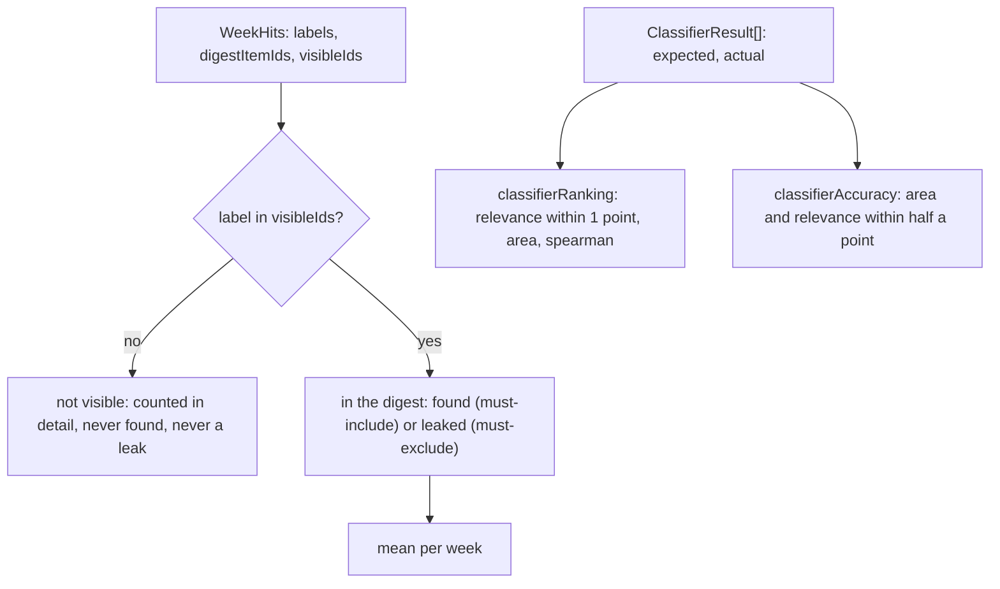

# Ranking metrics

> Scores what the pipeline kept and how well it ranked. Entries: `mustIncludeRecall(weeks)`,
> `mustExcludeLeaks(weeks)` (`labelHits.ts`); `classifierRanking(results)`, `classifierAccuracy(results)`
> (`classifier.ts`); `spearman(pairs)` (`spearman.ts`).

## Flow

## Rules

- A label the replay did not serve cannot be found or leak. It is counted in `detail.notVisible`
  with a note, so recall is not blamed for items outside the replay window.
- The metric `classifierAccuracy` is computed by `classifierRanking`: the within-one share is the
  value; `area`, `relevanceWithinOne` and `spearman` are detail. The function `classifierAccuracy`
  is the older, stricter measure; the threshold sweep and the rescore replay keep it so their runs
  stay comparable. Same name, different measure.
- Areas compare trimmed and lower-cased. Tolerances add `EPSILON`, so a miss of exactly one point
  is not turned wrong by floating-point noise.
- `spearman` ranks ties by their mean rank; it is null with fewer than two pairs or no spread, and
  then left out of the detail.

## Files

| File            | Role                                                          |
| --------------- | ------------------------------------------------------------- |
| `labelHits.ts`  | `WeekHits`, `mustIncludeRecall`, `mustExcludeLeaks`           |
| `classifier.ts` | `ClassifierResult`, `classifierRanking`, `classifierAccuracy` |
| `spearman.ts`   | `spearman`, `RankPair`                                        |

Tests sit next to each file. No fixtures.

## Gotchas

- `evals/calibrate.ts`, `evals/rescoreReplay.ts` and `thresholds/split.ts` import `WeekHits`, the
  two label metrics and `classifierAccuracy` through the bridge in `../../metrics.ts`.
