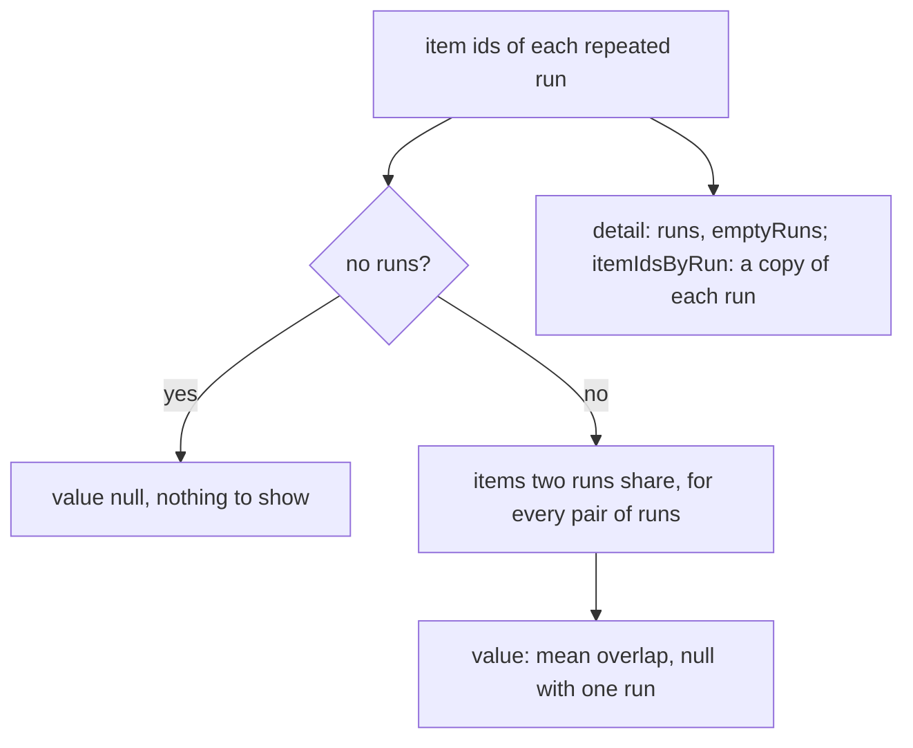

# Run metrics

> Scores the runs themselves: how much repeated runs of one week agree, and how long a week takes.
> Entries: `stability(runs, weekId?)` (`stability.ts`), `runTime(durationsMs)` (`runTime.ts`).

## Flow

## Rules

- A value of 0 can mean runs that picked different items or runs that produced nothing. Detail
  counts the runs and the empty ones, and `itemIdsByRun` keeps every run's ids, so a reader can tell.
- One run gives value null but still shows what ran. No runs give value null and no detail.
- `itemIdsByRun` holds copies: changing the input later changes nothing.
- `runTime` is reported, not gated: the mean per week, with the total in detail.

## Files

| File           | Role                                                      |
| -------------- | --------------------------------------------------------- |
| `stability.ts` | `stability`: mean pairwise overlap of repeated runs       |
| `runTime.ts`   | `runTime`: mean wall-clock time per week, total in detail |

Tests sit next to each file. No fixtures.

## Gotchas

- `stability` measures one repeated week. `stabilityAcrossWeeks` in `../../runEval.ts` builds the
  per-week view when several weeks were repeated, and names why a run was empty with
  `noDigestCause`.
- The gate is `GATES.stability`, a count of shared items (`../../metrics.ts`), not a share.
