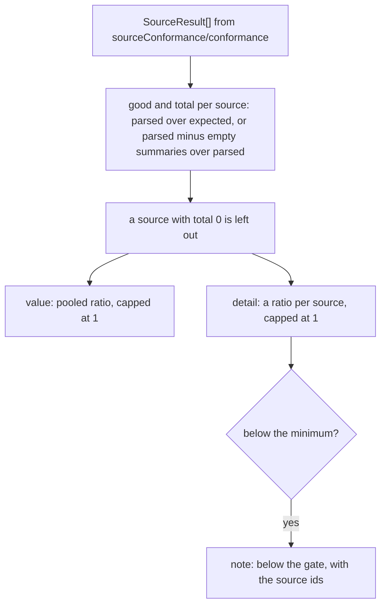

# Source metrics

> Scores the input side: how many items each recorded source yields and how many have a real
> summary. Entries: `sourceParse(results)`, `sourceSummaryFill(results)` (`sourceMetrics.ts`).

## Flow

- `sourceParse` adds `fetcher failed: <ids>` to the note for each source whose fetcher threw.

## Rules

- The thresholds `SOURCE_PARSE_MIN` and `SOURCE_SUMMARY_FILL_MIN` live here, next to the note that
  names the sources below them. `GATES` in `../../metrics.ts` reads them, so the gate and the note
  cannot drift.
- A source that yields more than expected is capped at 1: extra items must not hide a missing one.
- A source below the minimum by less than `EPSILON` is not flagged; a ratio exactly on it passes.
- Nothing is measured, and the value is null, when no source expects (or parsed) anything.

## Files

| File               | Role                                                                              |
| ------------------ | --------------------------------------------------------------------------------- |
| `sourceMetrics.ts` | `sourceParse`, `sourceSummaryFill`, `SOURCE_PARSE_MIN`, `SOURCE_SUMMARY_FILL_MIN` |

The test sits next to it. `evals/sourceMetrics.test.ts` runs the same functions with the gates in
`../../metrics.ts`, and old scorecards.

## Gotchas

- `MIN_SUMMARY_CHARS` (`../../sourceConformance/conformance/tally.ts`) decides what an empty summary
  is, so changing it moves `sourceSummaryFill`.
- Both metrics are soft: a weak source shows red and never fails the run.
