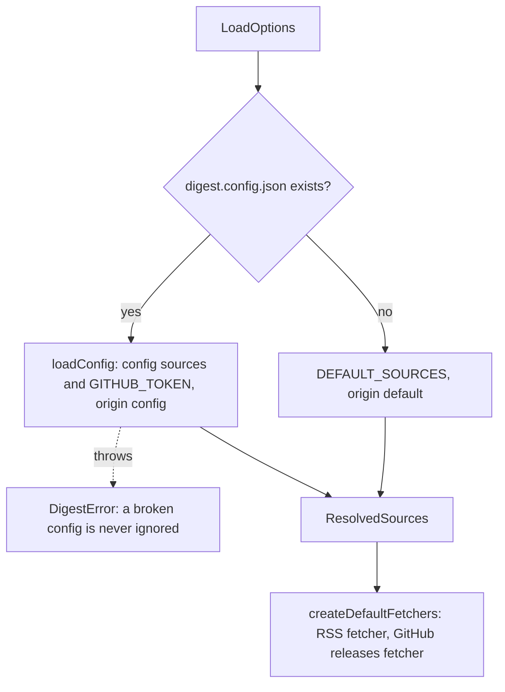

# Record fetchers

> Picks the sources to record and builds the real fetchers for them. Entries:
> `resolveSources(options) → ResolvedSources` (`resolveSources.ts`) and
> `createDefaultFetchers(githubToken, logger)` (`createDefaultFetchers.ts`).

## Flow

## Rules

- A config that exists but fails to load throws; only a missing file falls back to the defaults. The
  check is `pathExists` (`shared/fsErrors`): a path below a file (`ENOTDIR`) is missing too, and any
  other error from it (`EACCES`, `EIO`, a link that loops) throws, so a config it could not check is
  never swapped for the defaults.
- The GitHub token is `secrets.GITHUB_TOKEN` from `loadConfig`; this folder never reads `.env`.
- The RSS fetcher gets the logger only; the GitHub fetcher gets the token and the logger.
- A caller that passes its own `sources` or `fetchers` to `recordWeeks` skips this folder.

## Files

| File                       | Role                                                    |
| -------------------------- | ------------------------------------------------------- |
| `resolveSources.ts`        | `resolveSources`: config or default list, and the token |
| `createDefaultFetchers.ts` | `createDefaultFetchers`: the two real `SourceFetcher`s  |

`resolveSources.test.ts` reads `test/fixtures/config/`. `createDefaultFetchers.test.ts` wraps the
two adapter factories in spies and makes no request.

## Gotchas

- `evals/` may import `src/sources/adapters/*` and `src/config/load`; the pipeline features may not.
- `recordWeeks.test.ts` mocks the adapter factories at their module paths, so keep the imports of
  `createRssFetcher` and `createGithubReleasesFetcher` pointing there.
