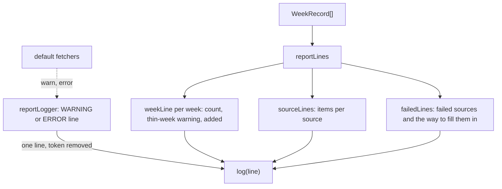

# Record report

> What `pnpm eval:record` prints. Entries: `reportLines(...) → string[]` (`reportLines.ts`) and
> `reportLogger(log, resolved) → Logger` (`reportLogger.ts`).

## Flow

- `reportLogger` lines come first, while the fetchers run. `reportLines` prints after the files are
  written. `debug` and `info` are dropped.

## Rules

- A line is one line: `oneLine` collapses any newline a feed put in an error text.
- The GitHub token is taken out of the message and every field (`createRedactor`), like any log line.
- A field value prints as it is when a string, as JSON when an object, else as `String(value)`.
- A week with fewer than `THIN_WEEK_MIN_ITEMS` items gets a warning: feeds often keep only 10-20.
- The listed sources print first, in order, with a count even at 0. A recorded source no longer in
  the list prints after them, so a retired feed's items stay visible.

## Files

| File              | Role                                                  |
| ----------------- | ----------------------------------------------------- |
| `reportLogger.ts` | `reportLogger`: the `Logger` the default fetchers get |
| `weekLine.ts`     | `weekLine`, `THIN_WEEK_MIN_ITEMS`                     |
| `reportLines.ts`  | `reportLines`, `sourceLines`, `failedLines`           |

Tests compare the lines exactly. Fixtures: `../__fixtures__/recordKit.ts`.

## Gotchas

- Tests and docs quote these lines (`Recorded 6 weeks`, `failed sources`, `pnpm eval:record again`).
- `reportLines` takes `Pick<ResolvedSources, 'sources' | 'origin'>`; it never sees the token.
