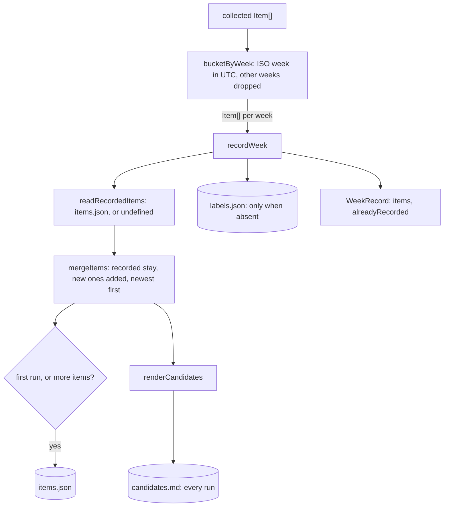

# Record weeks

> Sorts collected items into ISO weeks and writes one week's folder. Entries:
> `bucketByWeek(items, weekIds)` and `recordWeek(weekDir, weekId, collected) → WeekRecord`
> (`recordWeek.ts`). No port: it reads and writes files.

## Flow

## Rules

- `labels.json` is written with `writeIfAbsent` (`wx`): a hand-written label is never touched.
- A recorded item is kept as it is; the feed's newer copy of the same id is ignored.
- `items.json` is not rewritten when nothing is new, so a re-run leaves no diff.
- `readRecordedItems` returns `undefined` only for a missing file. A file that is not a list of
  items throws a `DigestError` naming the path: fix it or delete it, it is never overwritten.

## Files

| File                  | Role                                                                     |
| --------------------- | ------------------------------------------------------------------------ |
| `bucketByWeek.ts`     | `bucketByWeek`: a `Map` with every requested week, in order              |
| `renderCandidates.ts` | `renderCandidates`: the Markdown aid for picking labels by id            |
| `recordedItems.ts`    | `readRecordedItems`, `mergeItems`                                        |
| `writeFiles.ts`       | `writeIfAbsent`, `toJson`, `formatLikeRepo` (the repo's prettier config) |
| `recordWeek.ts`       | `recordWeek`, `LABELS_TEMPLATE`: the three files of a week               |

Tests sit next to each file and write to temp folders. Fixtures: `../__fixtures__/recordKit.ts`.

## Gotchas

- `formatLikeRepo` resolves the prettier config from the file path, so a test folder outside the repo
  gets prettier's defaults unless it holds its own `.prettierrc.json`.
