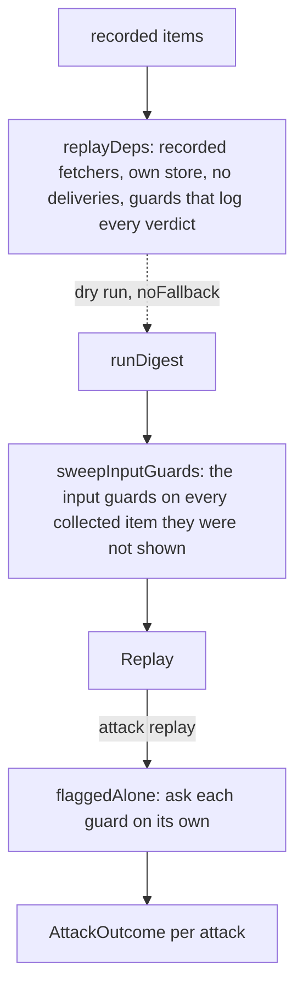

# Eval replay

> Runs `runDigest` as a dry run on recorded items and keeps what the guards said on the way.
> Entries: `replay(app, deps, weekId, items) → Replay` (`replay.ts`) and
> `replayAttacks(app, deps, week, attacks)` (`replayAttacks.ts`).

## Flow

## Rules

- A replay never touches the real app: an in-memory `createEvalStore`, no deliveries, a fixed clock
  at the end of the ISO week so the collect window is that week. Every guard is on, `topN` is 5 and
  `noFallback` is set, whatever the app config says: the metrics are defined on that.
- The fetchers serve only recorded items, newest first and capped like production (the source's
  `maxItems`, else `maxItemsPerSource`). `served` is what the pipeline could see: a label outside it
  is "not visible", not a miss.
- Attack items are dated one second before the week ends (the newest, so the worst case). An attack
  reaches the digest when its URL or its title appears anywhere in the text.
- A run shows the model input guards only the ranked candidates (PERF-2). `sweepInputGuards` then
  runs `guardInputStep` over every collected item (those with a verdict from the run), reusing each
  verdict the run got, so `guardFalseBlocks` keeps its population. It runs after the timing.
- `flaggedAlone` asks each enabled guard about each attack, one guard at a time (one model loaded),
  and reuses verdicts the pipeline already got. In mode `any` a later guard never sees an item an
  earlier one flagged.

## Files

| File                  | Role                                                                     |
| --------------------- | ------------------------------------------------------------------------ |
| `replay.ts`           | `replay`, `Replay`, `ReplayDeps` (the slice of `EvalDeps` it needs)      |
| `recordedItems.ts`    | `sourcesOf`, `servedIds`, `recordedFetchers`, `endOfWeek`, `newestFirst` |
| `guardVerdicts.ts`    | `recordInputGuards`, `recordOutputGuards`, `flaggedChecks`, `tallyOf`    |
| `evalStore.ts`        | `createEvalStore`                                                        |
| `replayAttacks.ts`    | `replayAttacks`, `flaggedAlone`, `reachesDigest`, `mentionsUrl`          |
| `sweepInputGuards.ts` | `sweepInputGuards`: the input verdicts the run did not ask for           |

Tests sit next to each file. `__fixtures__/replayKit.ts` builds a finished `Replay` by hand.

## Gotchas

- `Replay` is saved by `../checkpointReplay.ts`: a new field needs its schema too, or `--resume`
  loses it.
