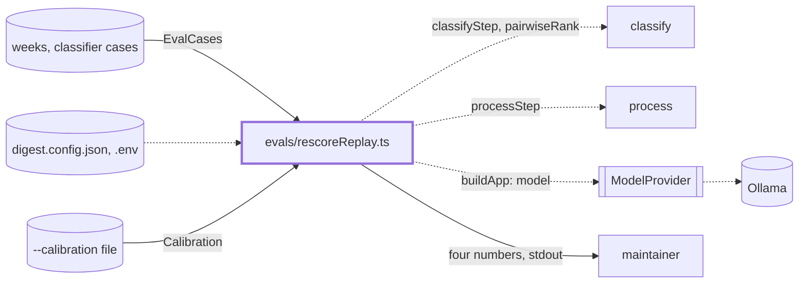
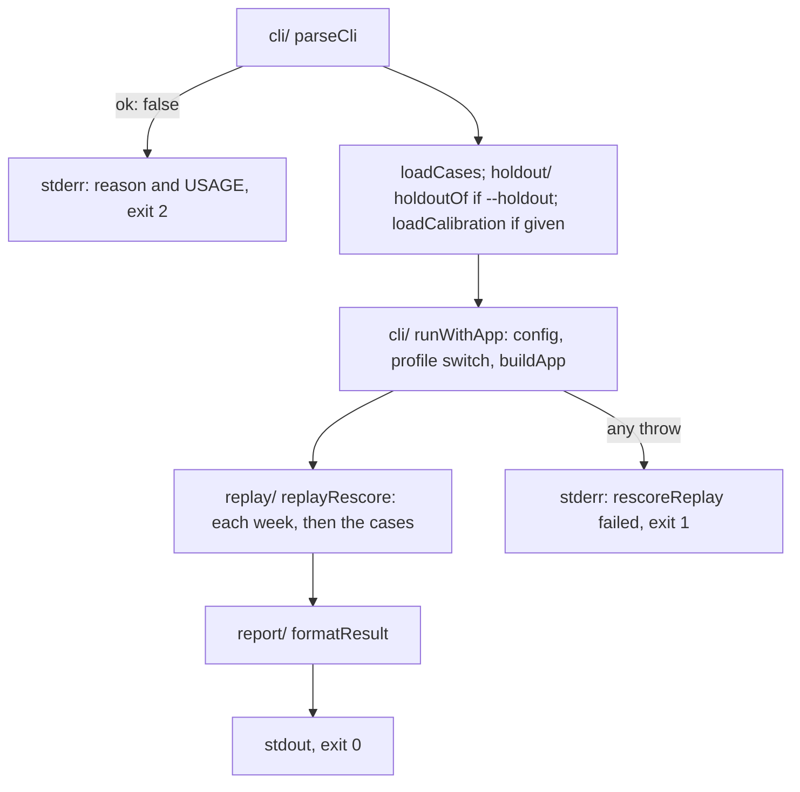

# Rescore replay

> Measures on the recorded weeks and classifier cases whether the writer rescore, a calibration or
> the pairwise re-rank helps. By hand on real models; reader page: `docs/evaluation/sets/classifier-cases.md`.
> Entry: `runCli(args, io)` returns an exit code (`evals/rescoreReplay.ts`, which stays at that path).

## Context

## Flow

- The replay runs classify and process only: no write step, no guards. `--flag` is
  `rescoreWithWriter`; `--pairwise on` adds the tournament; `--calibration` applies a file.

## Rules

- Top 5 whatever `topN` the local config says: the gate counts the top 5.
- Items are served as the real fetchers serve them: newest first, at most the source's cap.
- A real run only changes the profile of the loaded config, never the file on disk.
- `io.run` is the seam: tests pass a fake and never start an app.
- Exit 0 done, 1 failed, 2 usage.

## Files

| Path            | Role                                                                    |
| --------------- | ----------------------------------------------------------------------- |
| `replay/`       | `replayRescore` and its parts, `RescoreResult`. See `replay/CLAUDE.md`  |
| `report/`       | `formatResult`: the printed text. See `report/CLAUDE.md`                |
| `holdout/`      | `holdoutOf`: the named weeks, every third case. See `holdout/CLAUDE.md` |
| `cli/`          | `parseCli`, `USAGE`, `runWithApp`. See `cli/CLAUDE.md`                  |
| `__fixtures__/` | `rescoreKit.ts`: a week, two cases, scripted answers, a ticking clock   |

The entry file holds `runCli`, `RescoreCliIo` and the default input and output.

## Gotchas

- Docs and `src` comments name `evals/rescoreReplay.ts`: keep the path.
- `classifierAccuracy` here is the area-and-relevance function, not the scorecard metric of the
  same name (see `evals/CLAUDE.md`).
- The classifier cases use `thresholds/split.ts` `CASE_STRIDE`; if the split changes, the holdout does.
- Nothing in a weekly run uses a calibration or a pairwise order.
