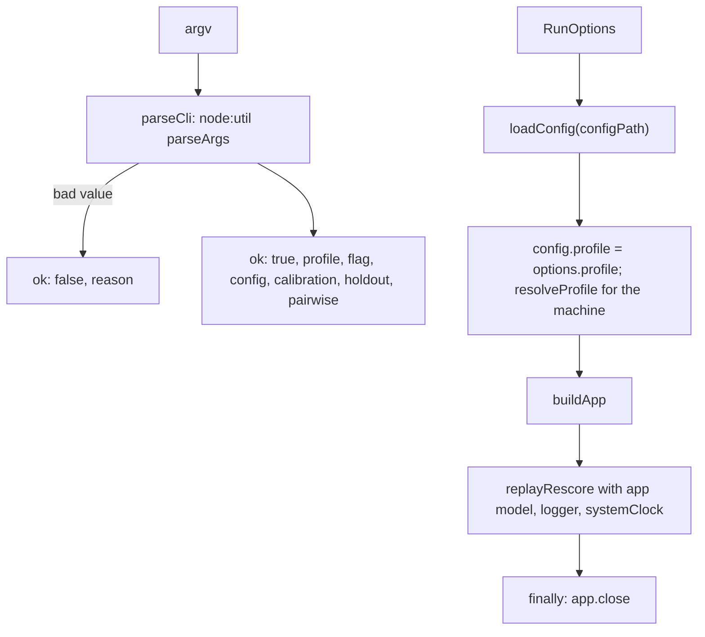

# Rescore command line

> Reads the command line and runs the replay on the real app. Entry: `parseCli(args)` returns a
> `ParsedCli`; `runWithApp(options, cases, rescore)` returns a `RescoreResult`. Port: none; it
> builds the app through `app/container`.

## Flow

## Rules

- `parseCli` never throws: an unknown option, a bad week id or a bad value is `ok: false` with a reason.
- `--profile` and `--flag` are required; `--pairwise` is `on` or `off`.
- `runWithApp` switches the profile in memory only; the config file stays as it is.
- The app is closed in `finally`, so a failed replay leaves no connection open.
- `USAGE` names every option and ends with a newline; the entry prints it after the reason.

## Files

| File            | Role                             |
| --------------- | -------------------------------- |
| `parseCli.ts`   | `parseCli`, `ParsedCli`, `USAGE` |
| `runWithApp.ts` | `runWithApp`, `RunOptions`       |

`runWithApp.test.ts` replaces `loadConfig`, `buildApp` and `replayRescore` with mocks.

## Gotchas

- `loadConfig` reads `digest.config.json` and `.env`; a test must mock it, never call it.
- `RunOptions` is the shape `RescoreCliIo.run` takes in `evals/rescoreReplay.ts`.
