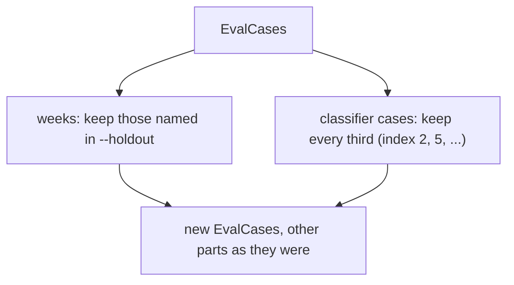

# Rescore holdout

> Cuts the eval set to the part a threshold or calibration was not tuned on. Entry:
> `holdoutOf(cases, weeks) → EvalCases` (`holdoutOf.ts`). Pure.

## Flow

## Rules

- The classifier rule is `CASE_STRIDE` of `evals/thresholds/split.ts`: the same cases the sweep
  holds out, so the two tools measure on the same data.
- Weeks keep their order in `cases`, not the order of `--holdout`.
- A name that matches no week keeps none; the classifier cases are cut either way.
- The input is not changed: attacks, grounding and sources are carried over as they are.

## Files

| File           | Role        |
| -------------- | ----------- |
| `holdoutOf.ts` | `holdoutOf` |

The test uses six cases and two weeks and checks which ids stay.

## Gotchas

- This is not `splitCapture`: it cuts `EvalCases` (what the replay reads), not a raw capture.
- `--holdout` week ids are checked in `cli/parseCli.ts`, not here.
