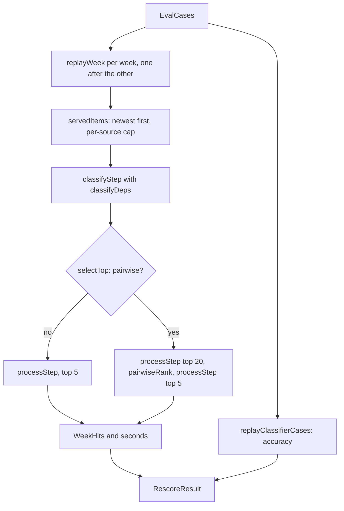

# Rescore replay run

> One pass of classify and select over the recorded weeks and the classifier cases, with the
> writer rescore flag at a given value. Port: `ModelProvider`, through `classifyStep`.
> Entry: `replayRescore(cases, deps, rescore)` returns a `RescoreResult` (`replayRescore.ts`).

## Flow

## Rules

- Weeks run one at a time: the machine holds one model.
- A week's time is classify plus select, read from the injected clock and never below 0.
- `visibleIds` are the served items: a label cut by the cap is neither found nor a leak.
- `calibrated` and `pairwise` are in the result only when on, so a plain result has no extra key.
- `topN` is `REPLAY_TOP_N` (5), not the config's.

## Files

| File                       | Role                                                                |
| -------------------------- | ------------------------------------------------------------------- |
| `types.ts`                 | `RescoreReplayDeps`, `RescoreResult`, `REPLAY_TOP_N`                |
| `replayInputs.ts`          | `servedItems`, `classifyDeps`                                       |
| `replayWeek.ts`            | `replayWeek`, `selectTop`: serve, classify, pick, time              |
| `replayClassifierCases.ts` | `replayClassifierCases`: accuracy on the cases, calibrated if given |
| `replayRescore.ts`         | `replayRescore`: the weeks, the cases, the means                    |

Tests sit next to each file; `../__fixtures__/rescoreKit.ts` scripts the model and the clock.

## Gotchas

- `classifyStep` and `pairwiseRank` are the real ones over a fake model: a prompt change there
  can move these tests.
