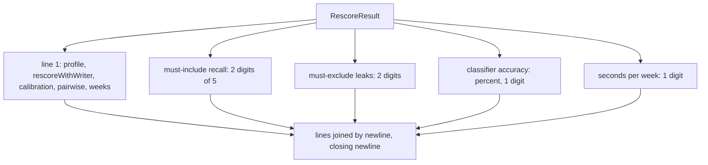

# Rescore report

> The text `evals/rescoreReplay.ts` prints: the flags in force and four numbers. Entry:
> `formatResult(profile, result) → string` (`formatResult.ts`). Pure.

## Flow

## Rules

- A number that was not measured (null) prints `n/a`.
- Flags print `on` or `off`; calibration and pairwise are `off` when the result lacks the key.
- The "of 5" is `REPLAY_TOP_N` from `../replay/types.ts`.
- The text is the command's output: `formatResult.test.ts` pins every character.

## Files

| File              | Role                                    |
| ----------------- | --------------------------------------- |
| `formatResult.ts` | `formatResult`: the lines of the report |

The test builds results by hand and compares the whole string once.

## Gotchas

- The accuracy is a share shown as a percent; the other numbers keep their scale.
- The line starts with `profile:` and the docs quote it. Change both together.
