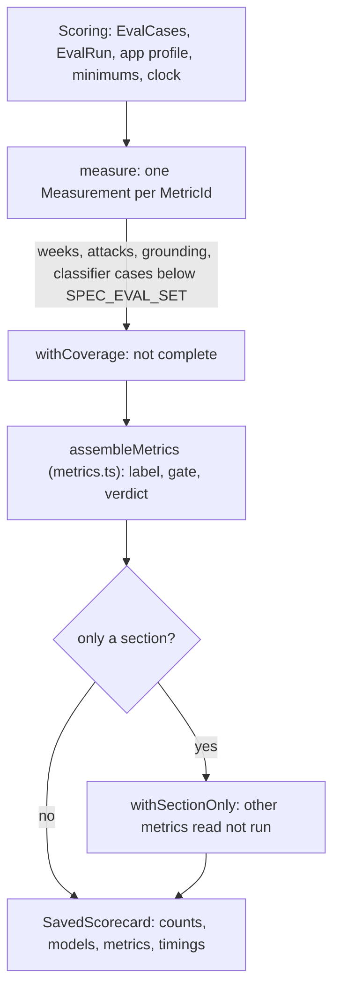

# Eval scoring

> Turns what one eval run gathered into a scorecard: one measurement per metric, then gates and
> labels. Entry: `buildScorecard(scoring: Scoring) → SavedScorecard` (`buildScorecard.ts`).

## Flow

## Rules

- Scoring is pure: it reads the `EvalRun` and the cases, never a file or a model.
- Stability keeps the first week as the gate, as in the older scorecards. Other weeks only add
  `byWeek`, and a week with an empty run is `no-digest`.
- The attack replay is compared with the first week's plain replay (`attackBaseline`, replayed on
  its own when only `guards` runs): a week that is blocked without attacks says nothing about them.
- Writing quality comes from the eval judge when it ran, else from the select step's scores of the
  winners. The calibration counts only for a profile that has a judge.

## Files

| File                      | Role                                                                     |
| ------------------------- | ------------------------------------------------------------------------ |
| `types.ts`                | `EvalRun`, `Scoring`, `WeekRun`, `StabilityWeek`, `AttackReplay`         |
| `measure.ts`              | `measure`, `calibrationFor`, `winnerScore`, attack and grounding pieces  |
| `replaySamples.ts`        | `idsOf`, `sampleOf`, `replayEndOf`, `hitsOf`: a `Replay` as metric input |
| `stabilityAcrossWeeks.ts` | `stabilityAcrossWeeks`                                                   |
| `buildScorecard.ts`       | `buildScorecard`, `withSectionOnly`                                      |

Tests sit next to each file. `__fixtures__/scoringKit.ts` builds a `Scoring` by hand.

## Gotchas

- `measure` returns `Record<MetricId, Measurement>`: a new metric id fails typecheck here until it
  has a measurement. The rest of the checklist is in `../CLAUDE.md`.
- `../runEval.ts` builds the `EvalRun`; the metric functions are in `../metrics/`.
