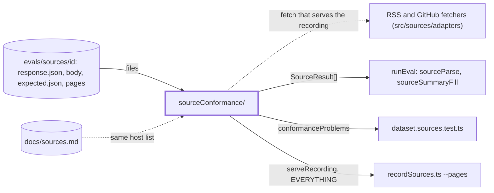
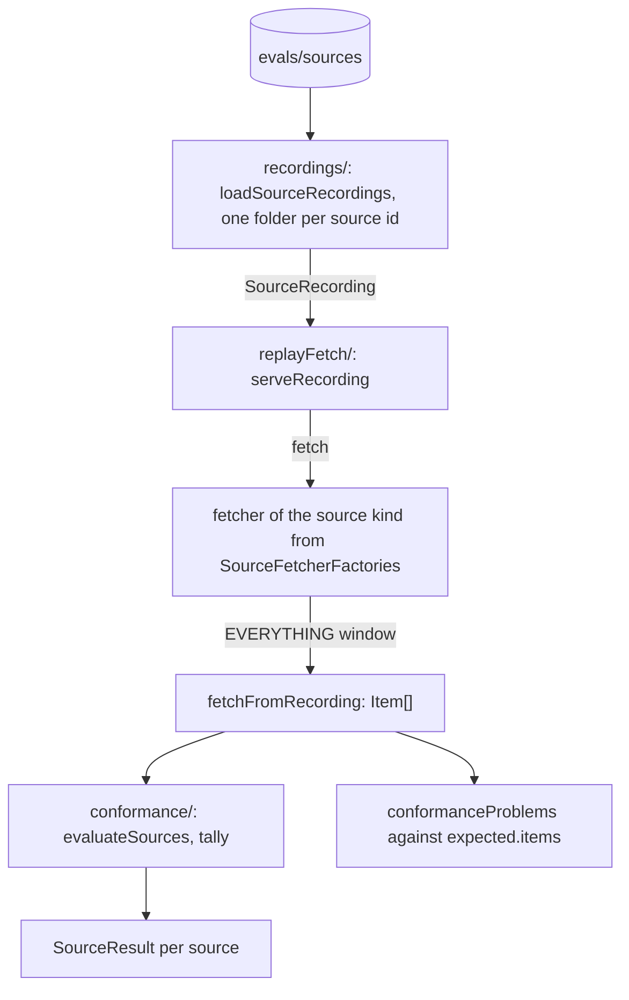

# Source conformance

> Runs every fetcher over the response the recorder saved for its source and counts what comes out.
> No network: the fetcher gets a `fetch` that serves the recording. Entries:
> `loadSourceRecordings(dir)`, `evaluateSources(recordings, factories) → SourceResult[]`,
> `conformanceProblems(actual, expected, knownGaps) → string[]`. `../sourceEval.ts` is the old path.

## Context

## Flow

- `recordings/` sits below `replayFetch/`, which sits below `conformance/`. None imports upward.
- The feed body is served for the recorded `response.url`; a recorded page for its URL; anything else
  is a 404 (`not recorded`).

## Rules

- Recorded bodies and pages are untrusted text: read them, serve them as strings, never run them.
- No network: only the injected `fetch` answers. A URL that was not recorded is a 404.
- `bodyFile` must name a file inside the source folder (`../` is refused); a folder with an error and
  no body is skipped; an unknown folder id, an unreadable file or a page that matches no expected
  item throws a `DigestError` naming the path.
- A fetcher that throws becomes a `SourceResult` with `parsed: 0` and the `error`, so one broken
  source does not hide the rest.
- A host outside `SOURCE_ALLOWED_HOSTS` counts as a defect. The list equals `docs/sources.md`; keep
  that test and its message.
- `knownGaps: ['summary']` skips only the summary in `conformanceProblems`.

## Files

| File               | Role                                                                   |
| ------------------ | ---------------------------------------------------------------------- |
| `recordings/`      | `SourceRecording` and loading it from disk. See `recordings/CLAUDE.md` |
| `replayFetch/`     | A recording served as `fetch`; the fetcher factories. See its doc      |
| `conformance/`     | Tally, allowlist, problems, `evaluateSources`. See its doc             |
| `../sourceEval.ts` | Bridges to the names above; callers outside the folder still use it    |

Tests sit next to each file. `__fixtures__/conformanceKit.ts` has `goodItem`, `recording` and `factoriesFor`.

## Gotchas

- `sourceEval.ts` holds no code: `// compat (W10-B23)` lines for the runEval folders, the source
  metrics and `dataset.sources.test.ts`. Remove them when the callers import from here.
- Page files are `pages/<item id>.html.txt`, not `.html`: prettier would try to format a page.
- Item ids hash the URL: a `normalizeUrl` change re-records every source.
- `MIN_SUMMARY_CHARS` (`conformance/tally.ts`) decides what an empty summary is, so changing it
  moves the `sourceSummaryFill` metric.
- A new default source needs a recording, a hand-checked `expected.json` and its host in
  `docs/sources.md`.
