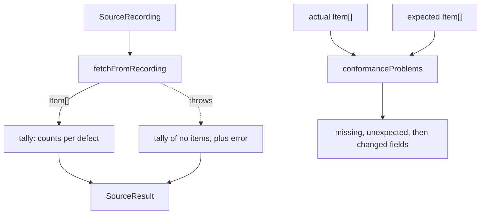

# Conformance

> Counts what a fetcher got wrong on a recording, and says how its items differ from the expected
> ones. Entries: `evaluateSources(recordings, factories) → SourceResult[]` (`evaluateSources.ts`),
> `conformanceProblems(actual, expected, knownGaps) → string[]` (`conformanceProblems.ts`).

## Flow

## Rules

- `evaluateSources` runs one source at a time, in the order given; a throw never stops the others.
- `tally` counts: items that fail `ItemSchema`, an empty title, a summary under `MIN_SUMMARY_CHARS`,
  a date that does not parse, an id that is not `itemIdFor(url)`, a host outside the allowlist.
- `isOutsideAllowlist` ignores a leading `www.` and case, and flags a URL it cannot parse. Its list
  equals the host line of `docs/sources.md` (`sourceAllowedHosts.test.ts`).
- `conformanceProblems` matches by item id and compares `COMPARED_FIELDS`; `summary` is skipped only
  for a source with the `summary` known gap.

## Files

| File                     | Role                                           |
| ------------------------ | ---------------------------------------------- |
| `types.ts`               | `SourceResult`                                 |
| `tally.ts`               | `tally`, `hasWrongId`, `MIN_SUMMARY_CHARS`     |
| `sourceAllowedHosts.ts`  | `SOURCE_ALLOWED_HOSTS`, `isOutsideAllowlist`   |
| `evaluateSources.ts`     | `evaluateSources`; private `evaluateOne`       |
| `conformanceProblems.ts` | `conformanceProblems`; private `fieldProblems` |

## Gotchas

- Tests use `goodItem` and `recording` of `../__fixtures__/conformanceKit.ts`.
- `SourceResult` (`types.ts`) reaches `runEval`, `scoring/` and `metrics/sources`: a new field also needs
  a metric and a scorecard entry. Changing `MIN_SUMMARY_CHARS` moves `sourceSummaryFill`.
