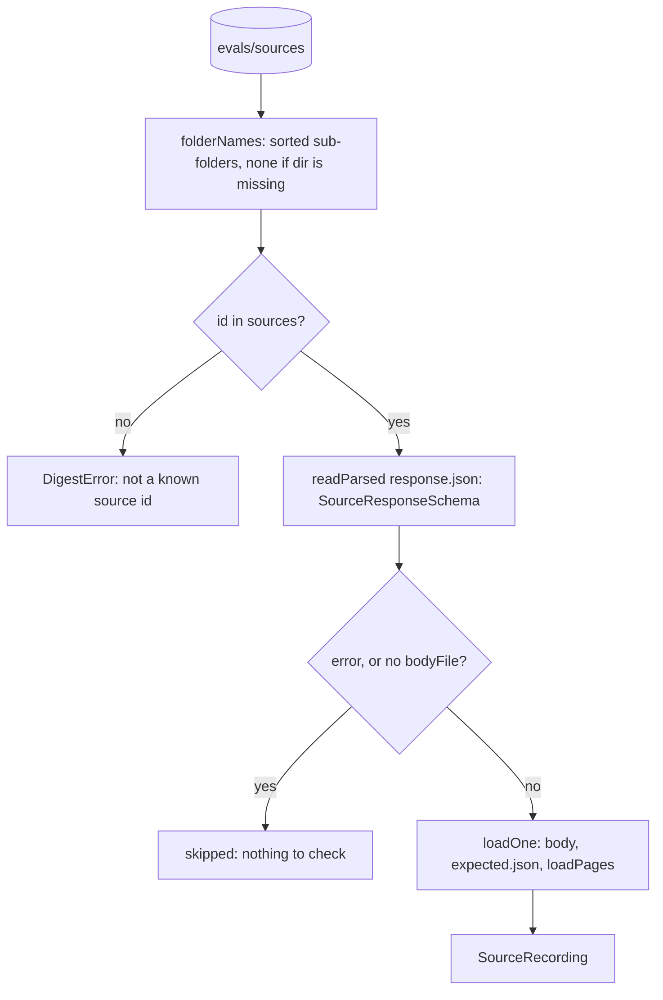

# Source recordings

> Reads `evals/sources/<id>/` into `SourceRecording` objects. Entry:
> `loadSourceRecordings(dir, sources?) → SourceRecording[]` (`loadSourceRecordings.ts`). The type is
> in `types.ts`. No port: it reads files.

## Flow

## Rules

- `bodyFile` is a bare file name; `../x` throws, so a response cannot point outside its folder.
- `readParsed` names the file for an unreadable file, bad JSON and a schema mismatch.
- A page file must be `<item id>.html.txt` and match an expected item; anything else throws.
- A missing `dir` or `pages/` folder is empty, not an error. Any other read error throws.
- Recorded text is returned as strings. Nothing here parses or runs it.

## Files

| File                      | Role                                                       |
| ------------------------- | ---------------------------------------------------------- |
| `types.ts`                | `SourceRecording`: source, response, body, pages, expected |
| `loadSourceRecordings.ts` | `loadSourceRecordings`; private `loadOne`                  |
| `loadPages.ts`            | `loadPages`: pages keyed by the URL of the expected item   |
| `readFiles.ts`            | `readParsed` (JSON plus schema), `folderNames`             |

Tests write temp folders. Fixtures: `../__fixtures__/conformanceKit.ts`.

## Gotchas

- `loadSourceRecordings` defaults to `DEFAULT_SOURCES`; a test with its own sources passes them.
- `evals/cases/loadEvalCases.ts` and `recordSources.ts` call it; the error texts are tested.
