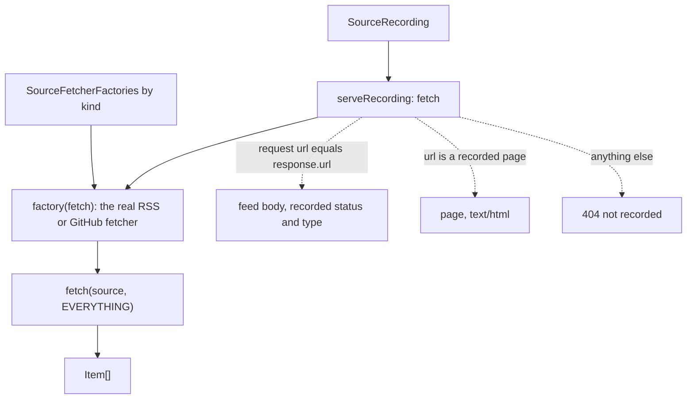

# Replay fetch

> Serves a recording as `fetch` and runs a fetcher over it. Entries: `serveRecording(recording)`
> (`serveRecording.ts`), `fetchFromRecording(recording, factories) → Item[]`
> (`fetchFromRecording.ts`), `defaultFetcherFactories` (`fetcherFactories.ts`).

## Flow

## Rules

- `EVERYTHING` is a window from epoch to the end of time with the largest cap (100), so a recording
  is never cut by dates or by the usual item cap.
- The recorded `status` is served as it was (default 200) and the `content-type` only when recorded.
- `Object.hasOwn` guards the page lookup: a URL such as `/constructor` is a 404, not a prototype key.
- `defaultFetcherFactories` builds the real adapters around the given `fetch`. A test with canned
  items passes its own `SourceFetcherFactories`.

## Files

| File                    | Role                                                                |
| ----------------------- | ------------------------------------------------------------------- |
| `serveRecording.ts`     | `serveRecording`; private `requestedUrl` (string, `URL`, `Request`) |
| `fetcherFactories.ts`   | `SourceFetcherFactories`, `defaultFetcherFactories`                 |
| `fetchFromRecording.ts` | `EVERYTHING`, `fetchFromRecording`                                  |

Tests need no network: the fetchers read the served recording.

## Gotchas

- `recordSources.ts --pages` imports `serveRecording` and `EVERYTHING` to find entries without text.
- `Response` adds a `text/plain` type to a string body when none is recorded.
