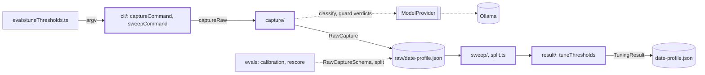
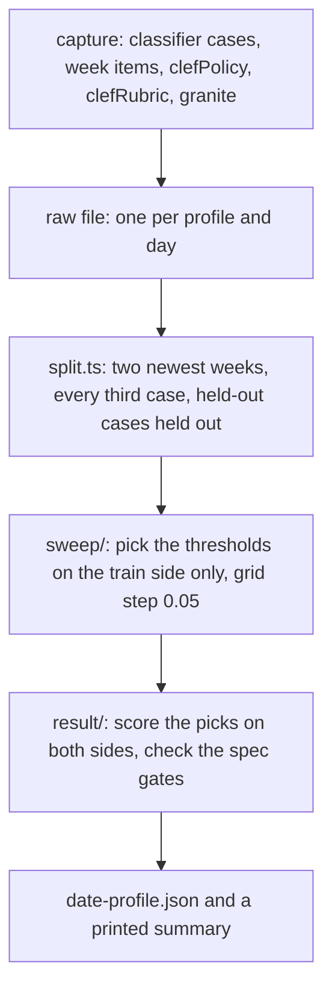

# Threshold tuning

> Sets four numbers from our own labeled data instead of by guess: `minRelevance`, `maxHype`,
> `maxMinorRelease` and `guardFlag`. The models run once per profile (`capture`); every later
> question is answered offline from the saved outputs (`sweep`). Entry: `evals/tuneThresholds.ts`
> (the command line) and `tuneThresholds(raw, split?)` (`result/tune.ts`). `README.md` has the
> method and the measured results.

## Context

## Flow

- Cases marked `heldOut: true` (21-30) are always on the holdout side and are not counted for the
  stride, so no threshold is picked on them.
- `capture` is the only step that calls a model. Sweep, split and result are pure.

## Rules

- A failed call is saved as `{ error }`, never lost, and a capture with failed calls exits 1 while
  the file is kept.
- The holdout never reaches the pick. The result file describes the train side; `scores` holds both
  sides and the gap, and a gap above 0.1 adds a warning.
- Files from before the split have no `split` or `scores` and still parse: add fields as optional.
- `sweep/keepsItem.ts` calls `passesThresholds` (`src/process/filter/thresholds.ts`), so the sweep
  and the process step share one rule.
- `raw/` and `<date>-<profile>.json` are data. Never edit them by hand; a new capture adds a file.

## Files

| Path                      | Role                                                                             |
| ------------------------- | -------------------------------------------------------------------------------- |
| `capture/`                | The raw-capture schema and the capture run. See `capture/CLAUDE.md`              |
| `sweep/`                  | Grid search, the classifier sweep, the guardFlag sweep. See `sweep/CLAUDE.md`    |
| `result/`                 | The result schema, `tuneThresholds`, acceptance, summary. See `result/CLAUDE.md` |
| `cli/`                    | The two commands, the files they write, the capture session. See `cli/CLAUDE.md` |
| `split.ts`                | Train and holdout split, side scores, the gap and its warnings, `CASE_STRIDE`    |
| `committedTuning.test.ts` | Drift guard: sweep on the committed `raw/` file gives the committed result       |
| `__fixtures__/`           | Test records, a scripted model with an eval set (`captureKit.ts`), a fake app    |
| `raw/`, `*.json`          | Data: raw captures and sweep results per profile. No `CLAUDE.md` needed          |
| `README.md`               | Method, profiles, measured results, the 80% gate, the split and its numbers      |

## Gotchas

- `evals/calibrate.ts` and `evals/calibration/` import `RawCaptureSchema` and `isFailed` from
  `capture/schemas` and use `split.ts`; `evals/rescore/` uses `split.ts` (`CASE_STRIDE`, `parseHoldoutWeeks`).
- `committedTuning.test.ts` fails when any number or key of the committed result changes. If the
  change is meant, re-run `sweep` on the committed raw file, review the diff, update the README table.
- Changing the raw schema breaks every saved capture. No test calls a model; `capture` costs GPU time.
