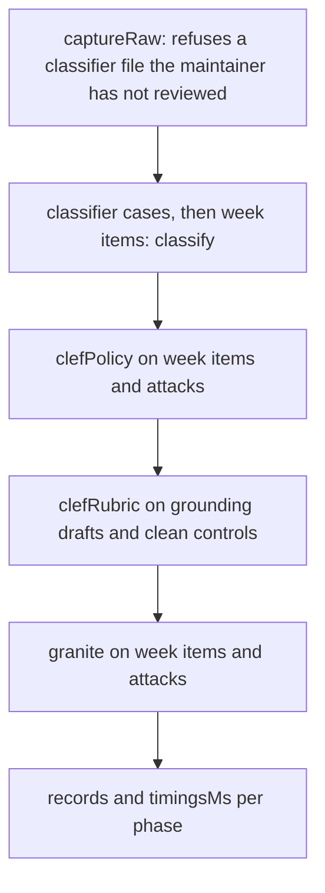

# Capture

> The raw outputs the threshold sweep works from, and the run that fills them. It calls each model
> once per subject and keeps the answers, so nothing later needs a model. Entry:
> `captureRaw(set, deps)` (`captureRaw.ts`).

## Flow

- `subjects.ts` says what is asked: `guardSubjects` (every week item as `clean`, then every attack)
  and `draftSubjects` (each grounding draft, then its control without the planted item).
- `calls.ts` makes the calls for one subject; `runner.ts` walks the subjects one at a time
  (`inTurn`), turns a thrown call into `{ error }` (`attempt`) and times each phase (`timed`).

## Rules

- A failed call never stops the run. Its message is saved; `failedCalls` and `totalFailed` count them
  so the command can exit 1 and keep the file. A guard verdict without a probability is a failed call.
- Calls run one at a time, the decision model first, then granite: Ollama holds one model at a time.
- The order of the phases and the keys of every record are the file layout. Old raw files must keep
  parsing, so add fields as optional.

## Files

| File            | Role                                                                                       |
| --------------- | ------------------------------------------------------------------------------------------ |
| `schemas.ts`    | `RawCaptureSchema`, the record types, `isFailed`, `failedCalls`, `totalFailed`             |
| `subjects.ts`   | `EvalSet`, `guardSubjects`, `draftSubjects`, `labelOf`                                     |
| `calls.ts`      | `ItemCallDeps`, `classifyItem`, `policyProbability`, `graniteVerdict`, `rubricProbability` |
| `runner.ts`     | `attempt`, `inTurn`, `timed`, `Progress`                                                   |
| `captureRaw.ts` | `captureRaw`, `CaptureDeps`: the five phases                                               |

`captureRaw.test.ts` runs the whole capture on a scripted model (`../__fixtures__/`).

## Gotchas

- Renaming a record key or a phase breaks every file in `../raw/`; `../committedTuning.test.ts`
  compares a fresh capture's keys with the committed one.
- `calls.ts` calls `classifyStep` (`src/classify/classify.ts`); `evals/calibration/` reads `schemas.ts`.
