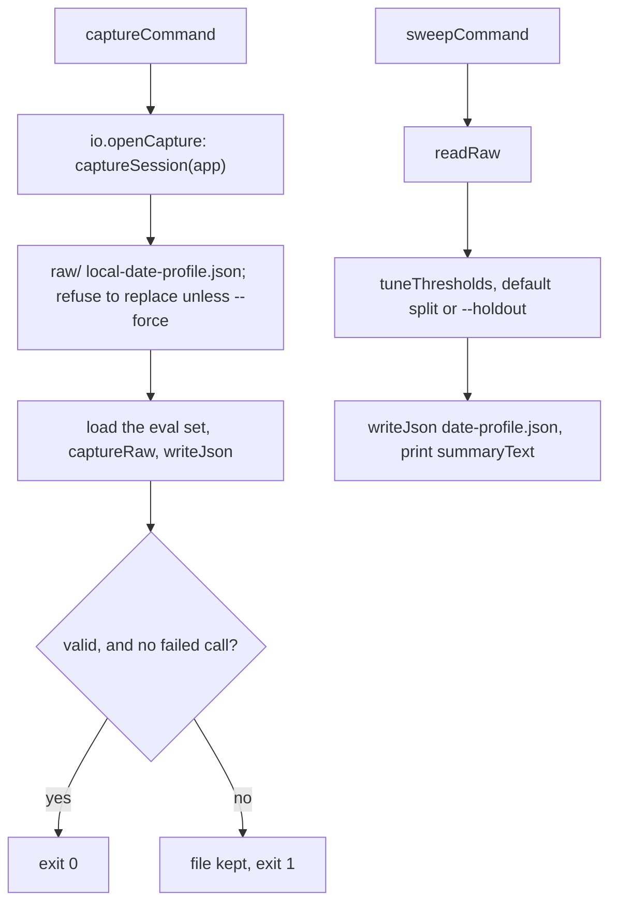

# Threshold commands

> What the two commands do, apart from reading the command line. `captureCommand(options, io)` calls
> the models and saves the raw outputs; `sweepCommand(rawPath, holdout, io)` reads them and saves the
> tuning result. The entry file `evals/tuneThresholds.ts` parses argv, wires the real app and calls these.

## Flow

- `captureSession` (`session.ts`) wraps the app `digest run` would build: it checks that Ollama answers
  and has every profile model, finds the three guards and closes the app if it cannot start.

## Rules

- `CliIo` (`io.ts`) is everything the commands need from outside: folders, the session opener, the
  eval-set loader, the clock and the two streams. Nothing here imports `app/container` (only its
  type), `config/load` or a model; the entry file does the real wiring.
- Exit codes: 0 done, 1 failed, 2 usage; the entry file maps a throw to `tuneThresholds failed: <message>`
  and exit 1. The "refuse to replace" check (`assertNew`, on `pathExists`) comes before any case is loaded
  or model is called; a capture path it cannot check (`EACCES`, `EIO`) stops the command the same way.

## Files

| File                | Role                                                                    |
| ------------------- | ----------------------------------------------------------------------- |
| `io.ts`             | `CliIo`, `CaptureSession`, `EXIT_OK`, `EXIT_FAILED`, `EXIT_USAGE`       |
| `files.ts`          | `localDate`, `writeJson` (repo prettier config), `assertNew`, `readRaw` |
| `session.ts`        | `captureSession`: the app, the Ollama check, the guards                 |
| `captureCommand.ts` | `captureCommand`, `CaptureOptions`                                      |
| `sweepCommand.ts`   | `sweepCommand`                                                          |

## Gotchas

- `capture` is the only command that costs GPU time: never run it from a test. Printed text and error
  messages are tested; argument parsing is tested in `evals/tuneThresholds.test.ts`.
