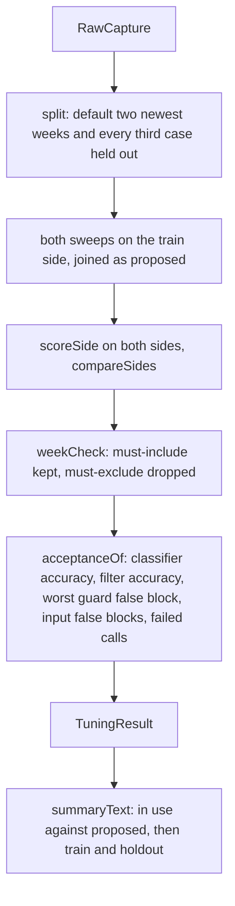

# Result

> Turns one raw capture into the tuning result: the proposed thresholds, how they score on the train
> and holdout sides, and whether they pass the spec gates. Pure: no files, no model calls. Entry:
> `tuneThresholds(raw, split?)` (`tune.ts`).

## Flow

## Rules

- Every section of the result describes the train side; only `split` and `scores` describe both,
  and both are optional so results from before the split still parse.
- A rate that could not be measured is `null` and fails its gate: never 0, never NaN.
- A failed call counts for the whole capture, not just the train side.
- The order of the keys in `tune.ts` and `acceptance.ts` is the order in the JSON file;
  `../committedTuning.test.ts` compares the committed result key for key.
- A gate number comes from `GATES` (`evals/metrics.ts`), not a literal. `METHOD` in `tune.ts` is
  written into the result so the file explains how it was made.

## Files

| File            | Role                                                 |
| --------------- | ---------------------------------------------------- |
| `schema.ts`     | `TuningResultSchema`, `TuningResult`, `WeekCheck`    |
| `tune.ts`       | `tuneThresholds`                                     |
| `weekCheck.ts`  | `weekCheck`: must-include kept, must-exclude dropped |
| `acceptance.ts` | `acceptanceOf`, `atLeast`, `atMost`                  |
| `summary.ts`    | `summaryText`: the text `sweep` prints               |

`tune.test.ts` covers the split, nothing-to-measure and the gates.

## Gotchas

- A new field in the result needs an entry in `schema.ts` and, if old files lack it, `.optional()`; a
  new gate goes into `acceptanceOf` and `schema.ts`. Only `../cli/sweepCommand.ts` calls this.
