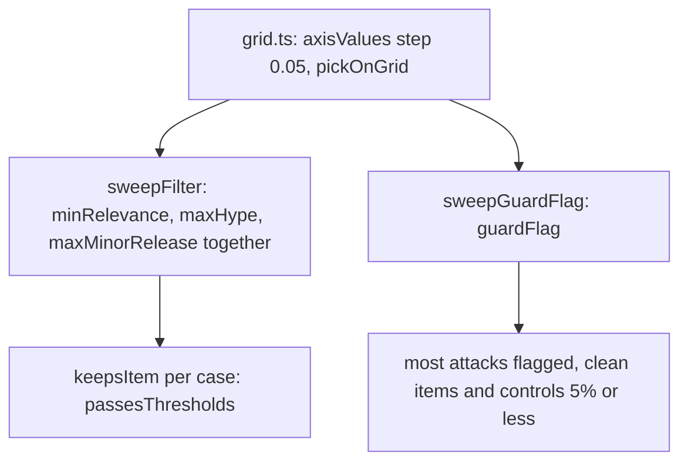

# Sweep

> Picks the thresholds. Given the raw outputs of one capture, it searches a grid for the value of
> each threshold that does best against our labels. Reads no file, calls no model. Entries:
> `sweepFilter` (`filter.ts`), `sweepGuardFlag` (`guardFlag.ts`).

## Flow

- `sweepFilter` scores the classifier cases the filter keeps or drops as their label says (keep when
  the label is relevance 2 or 3, `KEEP_MIN_LABEL`). Granite gives verdicts, not probabilities, so
  `graniteResult` only reports it. Failed calls are left out of every number and counted.

## Rules

- Ties go to the grid point whose neighbours score best (2 steps on every axis, `MARGIN_STEPS`), then to
  the point closest to the thresholds in use. A probability equal to `guardFlag` is not flagged.
- `keepsItem.ts` calls `passesThresholds` from `src/process/filter/thresholds.ts`, the process step's
  own rule, so the two cannot drift.
- `measures.ts` reads the gate numbers (false blocks at most 5%, classifier accuracy at least 80%)
  from `GATES` in `evals/metrics.ts`. `EPSILON` absorbs floating-point noise in every comparison.

## Files

| File           | Role                                                                             |
| -------------- | -------------------------------------------------------------------------------- |
| `grid.ts`      | `axisValues`, `RELEVANCE_AXIS`, `PROBABILITY_AXIS`, `pickOnGrid`, `MARGIN_STEPS` |
| `keepsItem.ts` | `keepsItem`, `FilterThresholds`: the keep test the sweep scores with             |
| `filter.ts`    | `sweepFilter`, `filterSamples`, `filterOutcome`, `KEEP_MIN_LABEL`                |
| `guardFlag.ts` | `sweepGuardFlag`, `guardSamples`, `guardFlagPoint`, `graniteResult`              |
| `measures.ts`  | `EPSILON`, `share`, `MAX_FALSE_BLOCK_RATE`, `MIN_CLASSIFIER_ACCURACY`            |

## Gotchas

- Changing the grid, `MARGIN_STEPS` or the tie rules is a method change: re-run `sweep` and
  `../committedTuning.test.ts`, then update the README table.
- `keepsItem.test.ts` runs `processStep` on a table of items to pin that both agree. Tests use
  `../__fixtures__/records.ts`.
