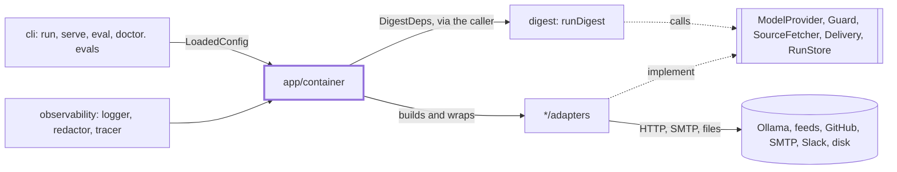
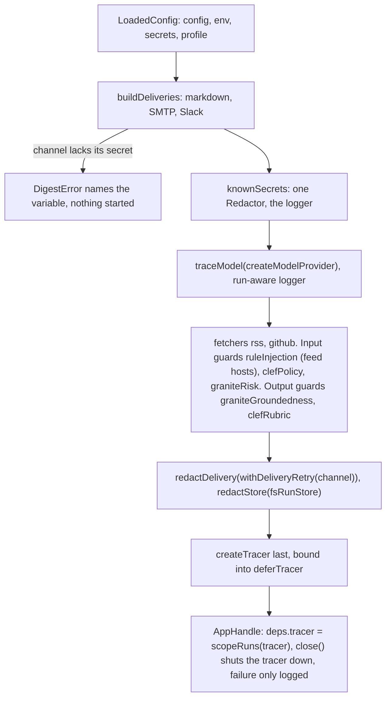

# App

> The composition root: turns a `LoadedConfig` into real adapters and a ready `DigestDeps`, and keeps
> secrets out of everything it builds. Entry: `buildApp(loaded) → Promise<AppHandle>` (`container.ts`),
> `AppHandle = { deps, close() }`. It owns no port; it plugs in all five.

## Context

## Flow

- Redaction is layered, so one leaky adapter ends up in none: adapters keep secrets out of errors; the
  logger and tracer redact their output (`redactValues`); `redactStore` covers artifact text and the run
  record, `redactDelivery` every text field of the message, its `DigestView` and the failure note. It
  wraps the retry, so every attempt sends the same message. Reads are untouched.

## Rules

- Secrets are checked first; errors name the variable, not its value. `buildApp` rejects, never throws.
- `knownSecrets` adds the Slack webhook path: it is the secret part, and a message can carry it alone.
- `redactStore` does not save a record that no longer fits `RunRecordSchema` after redaction (a secret
  equal to `"sent"` would rewrite the status): unsaved beats saved wrong.
- `redactDelivery` sends only the fields its `FieldRules` tables name: a field added later cannot leak.
- Retry only when sending again cannot double the message: 2 retries, 5 s then 10 s (cap 30 s), for
  connect-phase failures (`CONNECT_PHASE_CODES`, `CONNECT_PHASE_TIMEOUTS`), HTTP 429 and 5xx, SMTP 421,
  450, 451. Not after the body went out (reset, socket timeout). Reads `DeliveryError` facts, not text.
- Model, fetchers and guards are built once, but `digest serve` runs many weeks. `perRunLogger` looks up
  the logger of the run in flight (AsyncLocalStorage); `scopeRuns` sets it from the `runId` and `step`
  span attributes core passes. A callback started outside the run (an abort listener) sees no run.
- The tracer registers process-wide, so it is built last: a failure earlier leaves none registered.
  `traceModel` puts role, model and token counts on spans, never a prompt, text or answer.

## Files

| File                  | Role                                                                                                      |
| --------------------- | --------------------------------------------------------------------------------------------------------- |
| `container.ts`        | `buildApp`, `createModelProvider`, `samplingOf` (seed, temperature per role), `perRunLogger`, `scopeRuns` |
| `redacting.ts`        | `knownSecrets`, `redactStore`, `redactDelivery`, `FieldRules`                                             |
| `retryingDelivery.ts` | `withDeliveryRetry`, `isTransientDeliveryError`                                                           |
| `tracedModel.ts`      | `traceModel`, `deferTracer`                                                                               |

Tests: `container*.test.ts` (wiring, secrets, model, run logging, local output, Docker), one file for
each other file, and `scheduler*.test.ts`, which test `src/scheduler/scheduler.ts` (misplaced).

## Gotchas

- `redactStore` (all 9 `RunStore` methods), `redactDelivery`, `traceModel` and `withDeliveryRetry` list
  members by hand. A new port member or delivery field fails the typecheck; `unchanged` is for ids only.
- Container tests `vi.mock` each adapter module and wrap its factory in a spy that still builds the real
  one: moving a factory breaks them. `container.secrets.test.ts` guards that no secret reaches a log,
  trace, channel or the store; extend it with a new secret or channel.
- A guard built here runs only if `guards.input|output.checks` has a key for its id (`planGuards`): a new
  guard needs a line here and a key in `config/schema.ts`.
- `cli/show`, `cli/preview`, `cli/eval` call `knownSecrets`; `cli/doctor` and `cli/eval` call
  `createModelProvider` (doctor only `health()`, with its own `fetch`): keep it free of per-run state.
- `container.docker.test.ts` ties the default `delivery.markdown.dir` (`dist/digests`) to the
  `Dockerfile` WORKDIR, the `docker-compose.yml` mounts and `docker/validate.sh`.
