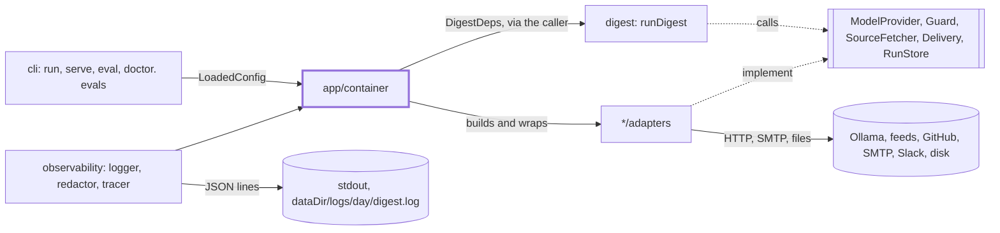
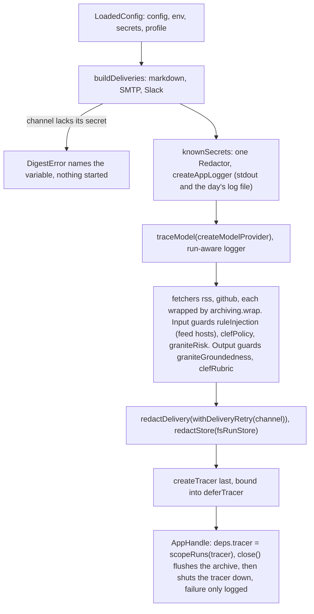

# App

> The composition root: turns a `LoadedConfig` into real adapters and a ready `DigestDeps`, and keeps
> secrets out of everything it builds. Entry: `buildApp(loaded) → Promise<AppHandle>` (`container.ts`),
> `AppHandle = { deps, close() }`. It owns no port; it plugs in all five and wraps four of them.

## Context

## Flow

- Redaction is layered, so one leaky adapter ends up in none: adapters keep secrets out of errors; the
  logger and tracer redact their output (`redactValues`); `redactStore` covers artifact text and the run
  record, `redactDelivery` every text field of the message, its `DigestView` and the failure note. It
  wraps the retry, so every attempt sends the same message. Reads are untouched.
- Guards are not wrapped; the ones that ask a model do so through the traced one, so their calls show as spans.

## Rules

- Secrets are checked first; errors name the variable, not its value. `buildApp` rejects, never throws.
- The `RunStore`, `Delivery` and `ModelProvider` decorators are built by `decorate` from a `MemberRules`
  table, one rule per member of the port, optional ones too: a new member fails the typecheck, in the
  table and in that decorator's test, until it says how it is wrapped. A member with no rule is not
  copied. The `SourceFetcher` wrapper (`archiving.wrap`, in `sources`) is written by hand.
- `redactStore` does not save a record that no longer fits `RunRecordSchema` after redaction (a secret
  equal to `"sent"` would rewrite the status): unsaved beats saved wrong.
- Redact outside the retry, so a retried send carries the same redacted message. Retry only when sending
  again cannot double the message (see `deliveryRetry/CLAUDE.md`).
- Model, fetchers and guards are built once, but `digest serve` runs many weeks. `perRunLogger` looks up
  the logger of the run in flight (AsyncLocalStorage); `scopeRuns` sets it from the `runId` and `step`
  span attributes core passes. A callback started outside the run (an abort listener) sees no run.
- A run archives what each source answered: `createSourceArchiving` gives the rss and github
  fetchers its `tap` and wraps them. The day folder is `weekDay(runId)`, read from the run in flight
  like the logger; a fetch outside a run saves nothing. The archive gets the app's redactor. Saves
  run in the background, so `close()` calls `archiving.flush()` first, before the tracer shutdown.
- The tracer registers process-wide, so it is built last: a failure earlier leaves none registered.
  `traceModel` puts role, model and token counts on spans, never a prompt, text or answer.

## Files

| File                  | Role                                                                                                                         |
| --------------------- | ---------------------------------------------------------------------------------------------------------------------------- |
| `container.ts`        | `buildApp`, `createAppLogger`, `createModelProvider`, `samplingOf` (seed, temperature per role), `perRunLogger`, `scopeRuns` |
| `decorate.ts`         | `decorate`, `MemberRules`: a port decorator from one rule per member                                                         |
| `redacting.ts`        | `redactStore`, `redactDelivery` (their rule tables); re-exports `knownSecrets` for `cli` until callers move                  |
| `redaction/`          | `knownSecrets`; the field rules of a delivery message and note. See `redaction/CLAUDE.md`                                    |
| `retryingDelivery.ts` | `withDeliveryRetry`, `DeliveryRetryOptions`: 2 retries, 5 s then 10 s (cap 30 s)                                             |
| `deliveryRetry/`      | `isTransientDeliveryError`: which failures are safe to send again. See `deliveryRetry/CLAUDE.md`                             |
| `tracedModel.ts`      | `traceModel`, `deferTracer`; under 100 lines, so it has no folder                                                            |

Tests: `container*.test.ts` (wiring, secrets, model, run logging, local output, Docker) and one file
for each other file. The decorator tests hold a `Record<keyof Port, …>` table that calls every member.

## Gotchas

- `unchanged` in `redaction/deliveryFields.ts` is for ids set in code only; a new text field needs `text`.
- Container tests `vi.mock` each adapter module and wrap its factory in a spy that still builds the real
  one: moving a factory breaks them. `container.secrets.test.ts` guards that no secret reaches a log,
  trace, channel or the store; extend it with a new secret or channel.
- A guard built here runs only if `guards.input|output.checks` has a key for its id (`planGuards`): a new
  guard needs a line here and a key in `config/schema.ts`.
- `cli/show`, `cli/preview` call `knownSecrets`; `cli/eval` calls `createAppLogger` and
  `createModelProvider`; `cli/doctor` calls `createModelProvider` (doctor only `health()`, with its own `fetch`): keep it free of per-run state.
- `container.docker.test.ts` ties the default `dataDir` (`dist`, `/app/dist` in the image) to the
  `Dockerfile` WORKDIR and CLI path, the `docker-compose.yml` mount (`./dist:/app/dist`) and
  `docker/validate.sh`.
