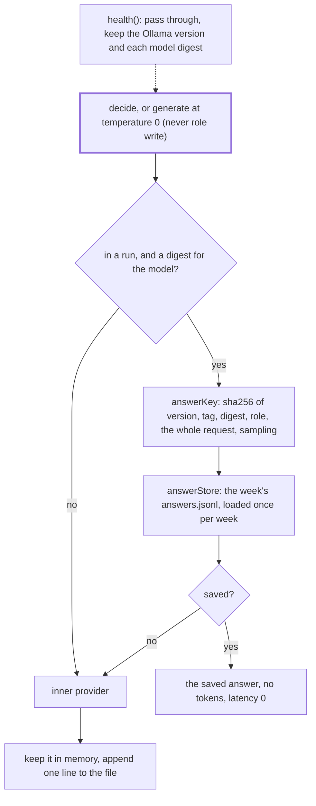

# Answer cache

> A `ModelProvider` decorator: a rerun of a week reuses what an earlier run of that week got for the
> very same call, so the input guards and classify do not run twice. Entry:
> `withAnswerCache(provider, loaded, run) → ModelProvider` (`withAnswerCache.ts`); the decorator
> is `cacheAnswers` (`cachedModel.ts`). The container wraps it inside `traceModel`.

## Flow

## Rules

- A key covers every byte the model reads and who answers it. A changed prompt or question, a new
  pull (another digest) or an Ollama upgrade is a miss, never a stale answer.
- `health()` sets the digests. `runDigest` calls it first in every run, so a pull between runs is
  seen. Before that, outside a run, or for a model Ollama lists no digest for, calls go straight to
  the model. `digest eval` builds the app with `reuseAnswers: false`, so it never caches: its
  replays measure the models, run each week three times and must write nothing to the data folder.
- Writers are never cached: they sample above 0, and a rerun may want a fresh draft.
- A line holds the key, the op, the model and the answer, never a prompt. Granite text goes through
  the redactor. An unreadable line is skipped and counted. The file cannot be read: the run starts
  empty. It cannot be written: answers stay in memory for the run. Neither ever fails a run.
- A reused answer still checks the abort signal, and a failed call saves nothing.

## Files

| File                 | Role                                                                    |
| -------------------- | ----------------------------------------------------------------------- |
| `withAnswerCache.ts` | `withAnswerCache`: the store, the profile and the effective sampling    |
| `cachedModel.ts`     | `cacheAnswers`, `AnswerCacheOptions`: the decorator (`MemberRules`)     |
| `answerKey.ts`       | `decideKey`, `generateKey`, `ModelIdentity`, `SamplingSettings`         |
| `answerStore.ts`     | `createAnswerStore`, `StoredAnswer`: one JSON line per answer, per week |

Tests sit next to each file; `container.model.test.ts` checks the wiring end to end.

## Gotchas

- The file is `<dataDir>/<monday>/digest/answers.jsonl` (`store/layout.ts`, `weekAnswersFile`).
  `pruneWeekFolder` keeps only the delivered files of an old week, so it goes with the week.
- To make a rerun ask every model again, delete the week's `answers.jsonl`.
- A new field that changes what a model reads must reach the key, or bump `KEY_VERSION`.
