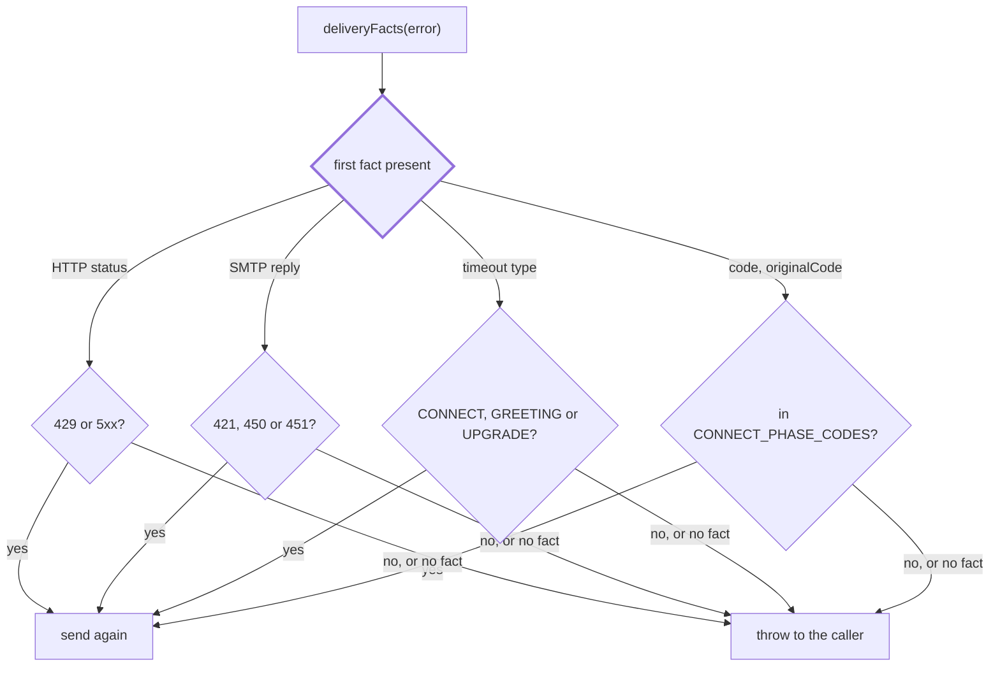

# Delivery retry

> Which delivery failures are safe to send again. Entry: `isTransientDeliveryError(error) → boolean`
> (`transientError.ts`), the `shouldRetry` of `withDeliveryRetry` in `../retryingDelivery.ts`.
> Port: `Delivery`. The error is a `DeliveryError`, or a raw nodemailer or fetch error.

## Flow

## Rules

- Retry only when sending again cannot put a second copy in the channel: the failure came before the
  body was written (connecting), or the server answered that it did not take the message.
- The typed facts decide, never the message text: text can be redacted or reworded, and a message that
  says "503" is not a status. The first fact present wins, in the order above: HTTP 404 with
  `ECONNREFUSED` underneath is not retried.
- A reset, a broken pipe, a socket timeout or a request timeout is not retried: the body may be out.
- A message can still go out twice when the server took it and then answered 429, 5xx, 421, 450 or 451.

## Files

| File                | Role                                                                       |
| ------------------- | -------------------------------------------------------------------------- |
| `transientError.ts` | `isTransientDeliveryError`, the code sets, the retryable HTTP status range |

`transientError.test.ts` is a table of facts. No fixtures.

## Gotchas

- Change the facts and the rule together: `delivery/adapters/errors/` (`deliveryError.ts`, `redact.ts`) set and
  keep them, and `delivery/adapters/deliveryRetry.test.ts` runs the real adapters through `withDeliveryRetry`.
- Delays and the retry count (2 retries, 5 s then 10 s) live in `../retryingDelivery.ts`, not here.
