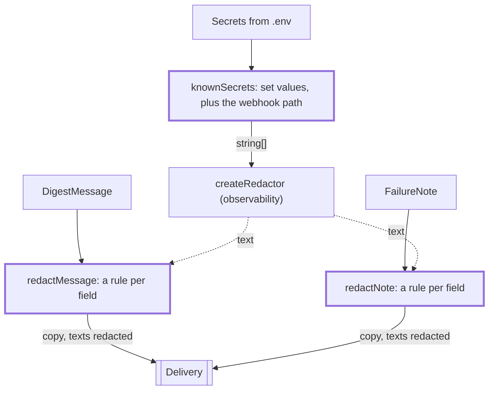

# Redaction

> Which values are secret, and how a delivery message loses them. Entries: `knownSecrets(secrets)`,
> `redactMessage(message, redactor)`, `redactNote(note, redactor)`. `redactDelivery` in
> `../redacting.ts` calls the last two for the `Delivery` port; `container.ts` calls `knownSecrets`.

## Flow

## Rules

- `knownSecrets` adds the Slack webhook path: it is the secret part, and a message can carry it alone.
  Unset and empty secrets are left out: there is nothing to hide.
- Every field of a delivery type has a rule (`FieldRules<T>`, optional fields too): a field added later
  is a type error until it says `text` or `unchanged`.
- Only the fields with a rule are sent. A field the type does not know (an object built with a cast)
  is dropped, so a field added later cannot leak. An absent field stays absent.
- `unchanged` is for ids set in code (week, step, urgency), never for text from a feed, a model or
  an error. A URL is `text`: a token can sit in its query string.

## Files

| File                | Role                                                                                        |
| ------------------- | ------------------------------------------------------------------------------------------- |
| `knownSecrets.ts`   | `knownSecrets`: every secret value that is set, plus the Slack webhook path                 |
| `deliveryFields.ts` | `redactMessage`, `redactNote`, `FieldRules`; the rule tables for message, view, group, item |

Tests sit next to each file, no fixtures.

## Gotchas

- `cli/show` and `cli/preview` import `knownSecrets` from `app/redaction/knownSecrets`.
- A new `DigestMessage` or `DigestView` field reaches email, Slack and the file only after it has a rule here.
- `app/redacting.test.ts` and `container.secrets.test.ts` pin the end result: no secret reaches a channel.
