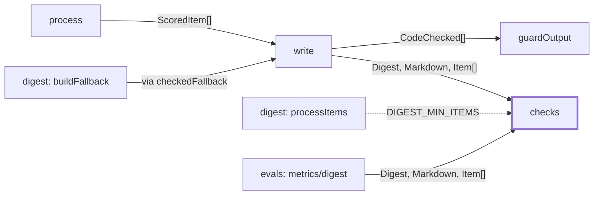
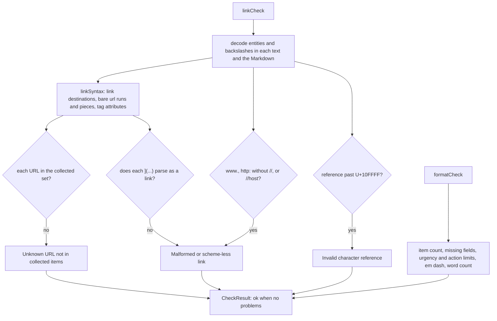

# Checks

> Two code checks every draft must pass: the link check (only collected URLs) and the format check
> (shape and length). A model, or a prompt injected through a feed item, can break both.
> Entry: `linkCheck(digest, markdown, items)` and `formatCheck(digest, markdown)`, each returning
> `CheckResult { ok, problems }`. Not a chain step: `write` calls them.

## Context

## Flow

- `write/checkedStep/codeCheck.ts` renders the draft with `renderDigest`, runs both checks and names a failing
  one in `rejectedBy` (`linkCheck`, `formatCheck`). Format problems come first, link problems after.
- Limits (`DIGEST_*` in `formatCheck.ts`, imported by the write prompt): 3-5 items, under 500 words
  (500 fails), at most 3 `act-now`, action at most 20 words, summary at most 40. The prompt aims
  lower (400, 15, 30).
- Required: headline, intro, each item's summary and why-it-matters; an action on `act-now` and
  `worth-a-look` items (one problem for all, so bare items cannot crowd out the retry prompt).
- A word is a whitespace token with a letter or digit. `|` splits words; link targets `](...)`,
  `---` rows and bullets do not count, so the limit holds for any table layout.

## Rules

- Always on and pure: no config, env switch or `skip` argument; no I/O, model or logging. A looser
  rule is a security change: add a test that shows the bypass stays closed.
- Decode before looking, so `&#104;ttp`, `&colon;` and `\` tricks cannot hide a URL.
- A URL must match a collected one whole after `normalizeUrl` (drops `utm_*` and tracking params,
  fragment, host case, trailing slash): nothing may ride after a known prefix. So read at least as
  much as a renderer does (`linkSyntax.ts`): a bare URL is the whole run to whitespace or `<`
  (GFM), less trailing punctuation, a `)` without its `(`, and the `>` or backtick closing a
  `<url>` or `` `url` ``; the shorter pieces older versions read are checked too. Then
  `https://vendor.example)@evil.test/` is one unknown URL, not a known root plus text.
- A Markdown destination is `](`, `<...>` or a run with balanced parentheses, an optional title,
  `)`. Anything else, or a `](` that never closes, is malformed (at most 20 snippets are kept).
  `href=` and `src=` count only inside an HTML tag, never in a query (`?src=rss`).
- A URL that holds another URL passes only written as collected: a fragment or `utm_*` value that
  normalizing drops could carry a second link, which a renderer cuts out.
- A collected `https://www.host` URL, written as collected, is cut out before the malformed-link
  search. Any other `www.` (even glued to a word), `http:` without `//` or `//host` is rejected.
- An action is one plain line: link-like text (`LINK_IN_TEXT`) fails it, even a collected URL.
  Action and summary limits apply only to items with an `urgency`, so old digests still pass.
- Scans stay linear on hostile text; tests time them (1 s). Destinations are read by a scanner that
  resumes after what it read, not by a regex with a backtracking tail (`](  ` x 64 KB took 25 s).
  Problems quote model text: never put one in a prompt unmasked; `writePrompt.ts` masks links.

## Files

| File             | Role                                                                            |
| ---------------- | ------------------------------------------------------------------------------- |
| `linkCheck.ts`   | `linkCheck`: decodes the text, judges every URL-like thing, builds the problems |
| `linkSyntax.ts`  | How a renderer reads a link: destination scanner, bare url runs, tag attributes |
| `formatCheck.ts` | `formatCheck`, `LINK_IN_TEXT` and the exported limit constants (`DIGEST_*`)     |
| `types.ts`       | `CheckResult`                                                                   |

Tests sit next to each file (`linkCheck`, `.www`, `.action`, `.renderers`, `.attributes`,
`.hostile`, `formatCheck`, `.urgency`).

## Gotchas

- The prefixes `UNKNOWN_URL_PROBLEM`, `MALFORMED_LINK_PROBLEM` and `INVALID_REFERENCE_PROBLEM`
  (`linkCheck.ts`) start the problem texts above; `write/writePrompt.ts` (`LINK_PROBLEM_KINDS`) matches them
  and `writePrompt.retry.test.ts` runs the real check.
- `linkCheck` and `formatCheck` are plain strings in `rejectedBy` (saved in `drafts.json` and `run.json`);
  `evals/metrics/attacks/attackRun.ts` (`CONTENT_REJECTIONS`) and `evals/schema.ts` match them.
- The checks read the rendered Markdown. A template change in `src/render/` can move the word count
  or add link-like text; `render/markdown.fixtures.test.ts` runs both checks on its goldens.
- Bare URLs in text are found for `http(s)` only: a bare `ftp://host/x` passes the link check (known
  limit, `docs/operations/known-limits.md`). Markdown destinations of any scheme are checked.
- Strict on purpose, so a few harmless forms fail and the writer retries: a URL in `[brackets]`,
  one with `|` or `(` glued on, `<a href="known">x</a>`. The renderer never writes these.
- `render/markdown.ts` backslash-escapes `<` and `>`; this check decodes backslashes first, so the
  links it sees do not change (`render/markdown.html.test.ts` proves it).
