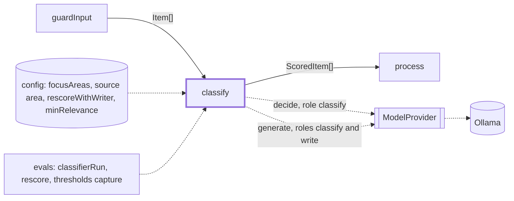
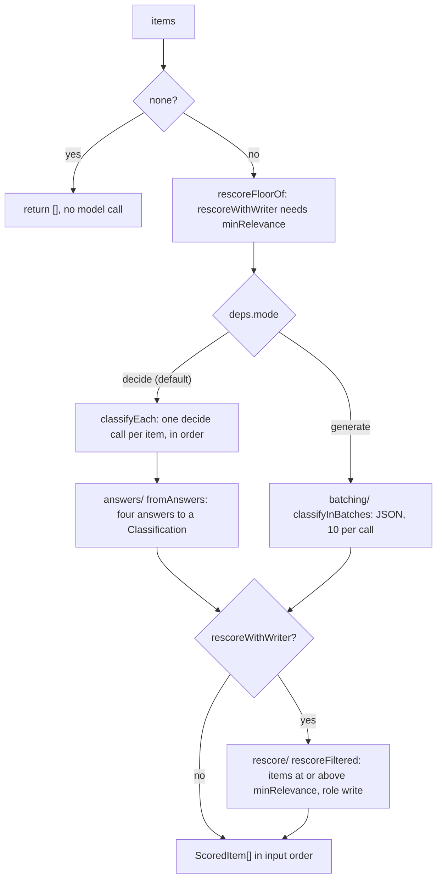

# Classify

> Scores every item that passed the input guards, so `process` can keep the 3-5 that matter.
> Entry: `classifyStep(items, deps) → ScoredItem[]` (`classify.ts`). It drops nothing: the
> thresholds are applied in `process`.

## Context

## Flow

- Four questions per item (`classifyQuestions`, ids in `QUESTION_IDS`): `relevance` 0-3
  (`RELEVANCE_LEVELS`), `area` (the focus areas plus `other`), `hype` and `minorRelease` (yes/no).
- A real run classifies in decide mode. The digest's classify stage passes `models.rescoreWithWriter`
  (off by default) and `thresholds.minRelevance`. No run sets `mode: 'generate'`: it is the JSON
  fallback for a model without decisions, pinned by tests (`batching/`, `classify.test.ts`).
- `pairwiseRank` (`pairwise.ts`, experiment): a short Swiss tournament over the first
  `PAIRWISE_TOP` (20) items, at most `PAIRWISE_MAX_CALLS` (40) decide calls. Each game asks in both
  orders and averages, to cancel first-item bias. Its ids feed `process`'s `pairwiseOrder`; only
  `evals/rescore/replay/replayWeek.ts` calls it. It takes no abort signal: no run uses it.

## Rules

- A missing or wrongly typed answer, or an area that is not an option, throws `DigestError` (step
  `classify`): a guessed score would ship a wrong digest. Values are validated, never clamped.
- Decide calls run one at a time: the decision endpoint takes one state per call.
- `ClassifierDeps.signal` (the run's abort signal) goes to every `decide` and `generate` call, and
  each call is preceded by `signal?.throwIfAborted()`. An abort rejects the step with the signal's
  reason: it is never a score, never an item the model "left out", and never a failed rescore
  batch (`rescoreBatch` rethrows when the signal fired, whatever the call threw).
- Decide mode logs a `Progress` line (`shared/progress`, label `classify`) every 25 items or minute,
  with the median call and the time left. `ClassifyDeps.clock` times it (the stage passes the run's).
- The area hint comes from config and sits outside the untrusted block. `tagText` flattens it to
  one line so it cannot add instructions. A blank hint means no hint.
- `rescoreWithWriter` without `minRelevance` throws before any model call.
- Classify reads items only the rule guard checked (PERF-2): the model input guards check the picks
  after `process`. That is safe because a decide call reads one item and answers fixed choices; it
  writes no text. The writer rescore does write, so with it on the model guards run first
  (`digest/stages/modelGuardsFirst.ts`).
- `areaOptions` removes duplicate focus areas and adds `other`, unless one already has that name.
- Subfolders take `ClassifierDeps` and never import `classify.ts`; `ClassifyDeps` adds the entry options.

## Files

| File                | Role                                                                                    |
| ------------------- | --------------------------------------------------------------------------------------- |
| `classify.ts`       | `classifyStep`, `ClassifyDeps`, `areaHintsOf`; the decide loop (`classifyEach`)         |
| `types.ts`          | `ClassifierDeps`: model, focus areas, logger, area hints; what every scoring path reads |
| `classifyPrompt.ts` | Questions, decide state, batch and rescore prompts; `QUESTION_IDS`, `RELEVANCE_LEVELS`  |
| `classification.ts` | `ClassificationSchema`, `ScoredItemSchema`: the types this feature owns                 |
| `pairwise.ts`       | `pairwiseRank`, `pairwiseState`, `PAIRWISE_TOP`, `PAIRWISE_MAX_CALLS`: the experiment   |
| `answers/`          | Decision answers to a `Classification`, and `classifyError`. See `answers/CLAUDE.md`    |
| `batching/`         | Generate mode: JSON batches, the retry, `chunk`, limits. See `batching/CLAUDE.md`       |
| `rescore/`          | The writer-model second pass over the shortlist. See `rescore/CLAUDE.md`                |

Tests sit next to each file; `__fixtures__/classifyKit.ts` has the scripted answers and replies.

## Gotchas

- Do not rename `QUESTION_IDS`: the digest and `test/integration` tests build fake answers with them.
- The no-hint prompt must stay byte-identical to the old one. `classifyPrompt.test.ts` pins it.
- A change to a question, a level text or a prompt moves the scores. Run the classifier cases in
  `evals/` before and after.
- `classifyStep` is also called by `evals/classifierRun/classifyCases.ts`, `evals/rescore/replay/`
  and `evals/thresholds/capture/calls.ts` (whose test mocks it). Keep its signature.
