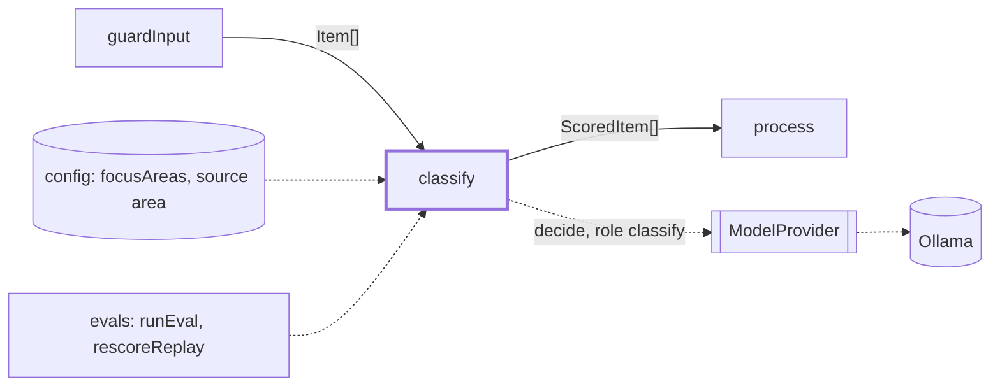
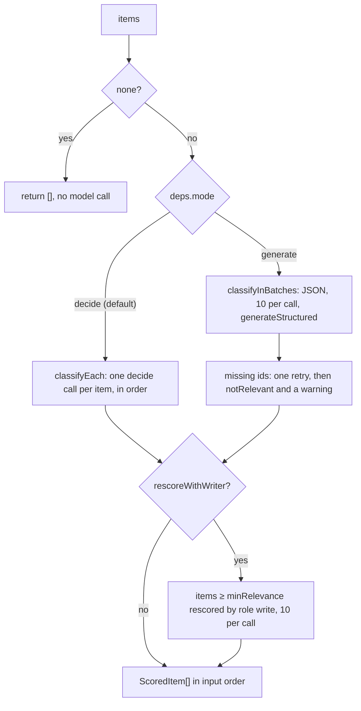

# Classify

> Scores every item that passed the input guards, so `process` can keep the 3-5 that matter.
> Entry: `classifyStep(items, deps) → ScoredItem[]` (`classify.ts`). It drops nothing: the
> thresholds are applied in `process`.

## Context

## Flow

- Four questions per item (`classifyQuestions`, ids in `QUESTION_IDS`): `relevance` 0-3
  (`RELEVANCE_LEVELS`), `area` (the focus areas plus `other`), `hype` and `minorRelease` (yes/no).
- `fromAnswers` turns them into a `Classification`: the expected level, the area's confidence, and
  the two yes probabilities.
- A real run uses decide mode and never rescores: `runDigest` passes only `model`, `focusAreas`,
  `logger` and `areaHints`. Generate mode runs in tests; rescoring only in `evals/rescoreReplay.ts`.
- `pairwiseRank` (`pairwise.ts`, experiment): a short Swiss tournament over the first
  `PAIRWISE_TOP` (20) items, at most `PAIRWISE_MAX_CALLS` (40) decide calls. Each game asks in both
  orders and averages, to cancel first-item bias. Its ids feed `process`'s `pairwiseOrder`; only
  `evals/rescoreReplay.ts` calls it.

## Rules

- A missing or wrongly typed answer, or an area that is not an option, throws `DigestError` (step
  `classify`): a guessed score would ship a wrong digest.
- Decide calls run one at a time: the decision endpoint takes one state per call.
- The area hint comes from config and sits outside the untrusted block. `tagText` flattens it to
  one line so it cannot add instructions. A blank hint means no hint.
- Rescoring: the writer's relevance replaces the decider's; its area only when it answers
  confidence `high`; hype and minorRelease stay. A failed batch keeps the decider's scores.
- `areaOptions` removes duplicate focus areas and adds `other`, unless a focus area already has
  that name.

## Files

| File                | Role                                                                                   |
| ------------------- | -------------------------------------------------------------------------------------- |
| `classify.ts`       | `classifyStep`, `ClassifyDeps`, `areaHintsOf`; the decide, generate and rescore paths  |
| `classifyPrompt.ts` | Questions, decide state, batch and rescore prompts; `QUESTION_IDS`, `RELEVANCE_LEVELS` |
| `classification.ts` | `ClassificationSchema`, `ScoredItemSchema`: the types this feature owns                |
| `pairwise.ts`       | `pairwiseRank`, `pairwiseState`, `PAIRWISE_TOP`, `PAIRWISE_MAX_CALLS`: the experiment  |

Tests sit next to each file and script `FakeModelProvider` (`test/fakes`). No fixtures.

## Gotchas

- Do not rename `QUESTION_IDS`: the digest and `test/integration` tests build fake answers with them.
- The no-hint prompt must stay byte-identical to the old one. `classifyPrompt.test.ts` pins it.
- A change to a question, a level text or a prompt moves the scores. Run the classifier cases in
  `evals/` before and after.
- `classify.ts` is 343 lines, over the 300 cap. Split the generate and rescore paths into
  subfolders before adding to it.
