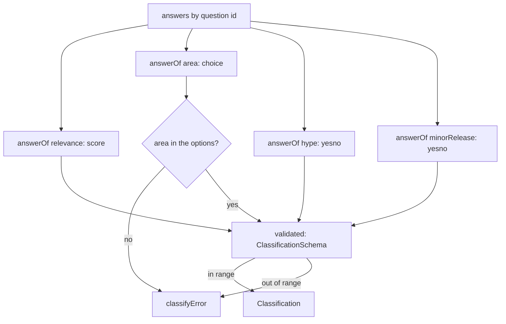

# Classify answers

> Turns one item's four decision answers into a `Classification`, and holds the step's error.
> Entry: `fromAnswers(itemId, answers, areas) → Classification` (`fromAnswers.ts`) and
> `classifyError(message) → DigestError` (`classifyError.ts`). No port: it reads decided answers.

## Flow

## Rules

- A missing or wrongly typed answer, or an area that is not an option, throws: a guessed score
  would ship a wrong digest.
- Values are validated, never clamped: relevance 0 to 3, every probability 0 to 1. An answer outside
  that is a bug in the endpoint to see, not hide. `fromAnswers.test.ts` pins the ends.
- Relevance is the expected level (a fraction such as 2.4). Every error is a `DigestError` of step
  `classify`, prefixed `classify: `.

## Files

| File               | Role                                                              |
| ------------------ | ----------------------------------------------------------------- |
| `fromAnswers.ts`   | `fromAnswers`; private `answerOf` (typed lookup) and `validated`  |
| `classifyError.ts` | `classifyError`; `classify.ts` also uses it for the rescore floor |

Tests call both directly; `answersFor` comes from `../__fixtures__/classifyKit.ts`.

## Gotchas

- Tests match the error texts (`got none`, `which is not an option`, `invalid answers for item`).
- `batching/` and `rescore/` do not use `classifyError`: `generateStructured` throws its own
  `DigestError` for step `classify`. `batching/` lets it fail the step; `rescore/` catches it.
