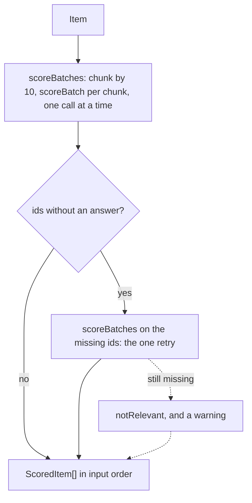

# Classify batching

> Generate mode: scores items as JSON, 10 per model call, for a model that cannot answer decisions.
> Entry: `classifyInBatches(items, deps: ClassifierDeps) → ScoredItem[]` (`classifyInBatches.ts`).
> Port: `ModelProvider.generate`, role `classify`, through `generateStructured`.

## Flow

## Rules

- `batchSchema` makes ids and areas enums: the model can name only items of the batch and the focus
  areas plus `other`. Anything else fails after one repair, with a `DigestError` of step `classify`.
- Relevance is an integer 0 to 3, rejected outside it, never clamped.
- The first answer for an id wins. Items left out get one retry, together, in their own batches;
  still missing, they become not relevant (relevance 0, area `other`, confidence 0) with a
  warning: throwing would lose the week.
- A generated tag has no probability: the area counts as certain (confidence 1), and hype and
  minorRelease are 0 or 1.
- Calls run one at a time, in batch order, at temperature 0.

## Files

| File                   | Role                                                                                    |
| ---------------------- | --------------------------------------------------------------------------------------- |
| `classifyInBatches.ts` | `classifyInBatches`: batches, the retry, the default; private `notRelevant`             |
| `scoreBatch.ts`        | `scoreBatch` (one call, logs a repair), `batchSchema`                                   |
| `chunk.ts`             | `chunk`: runs of at most `size`, in order                                               |
| `limits.ts`            | `BATCH_SIZE` 10, `MAX_RELEVANCE` 3, `GENERATED_AREA_CONFIDENCE`, `GENERATE_TEMPERATURE` |

## Gotchas

- No run uses this path; its only door is `ClassifyDeps.mode: 'generate'`. The tests pin it.
- `rescore/` imports `chunk` and `limits.ts` from here, so a new `BATCH_SIZE` also resizes the
  writer pass. This folder never imports `rescore/`.
